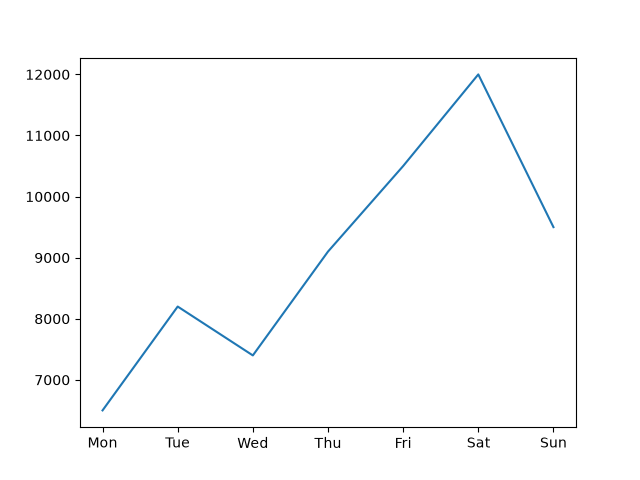
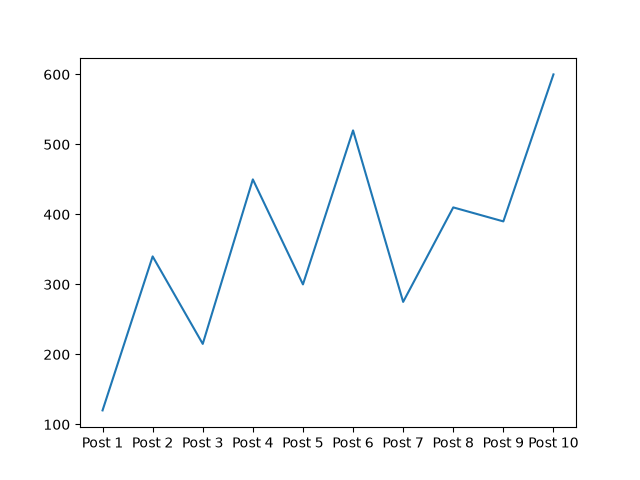
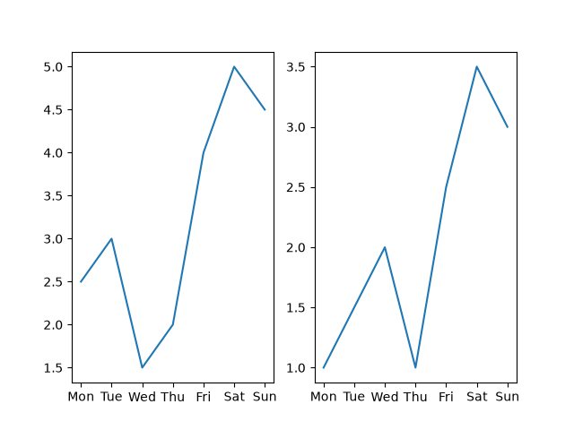
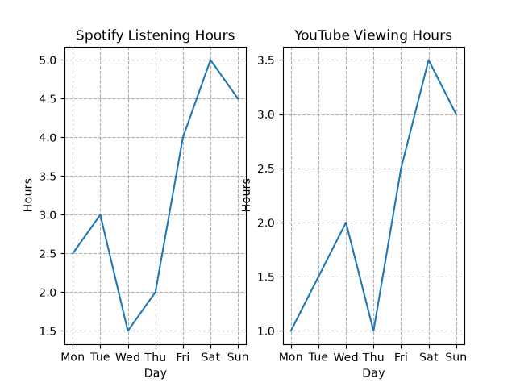

# Task 1
## Install Matplotlib in your Python environment and write a script named hello_plot.py that creates a simple line plot showing the number of daily steps you walked over the past 7 days.
### Code
```python
import matplotlib.pyplot as plt
days=['Mon','Tue','Wed','Thu','Fri','Sat','Sun']
steps=[6500,8200,7400,9100,10500,12000,9500]
plt.plot(days,steps)

plt.show()
```
### Output

<br>
<br>

# Task 2
## Create a script called insta_likes_plot.py that uses Matplotlib to plot the number of likes you received on your last 10 Instagram posts (use made-up data if needed), labeling the axes appropriately.
### Code
```python
import matplotlib.pyplot as plt
posts=[f"Post {i}" for i in range(1, 11)]
likes=[120,340,215,450,300,520,275,410,390,600]
plt.plot(posts,likes)

plt.show()
```
### Output

<br>
<br>

# Task 3
## Write a Python script that creates a Matplotlib figure with two Axes: one showing your daily Spotify listening hours for a week and the other showing your daily YouTube viewing hours for the same week. Display both plots in a single figure.
### Code
```python
import matplotlib.pyplot as plt
days=['Mon','Tue','Wed','Thu','Fri','Sat','Sun']
spotify_hours=[2.5,3.0,1.5,2.0,4.0,5.0,4.5]
youtube_hours=[1.0,1.5,2.0,1.0,2.5,3.5,3.0]
fig,(ax1,ax2)=plt.subplots(1,2)

ax1.plot(days,spotify_hours)
ax2.plot(days,youtube_hours)

plt.show()
```
### Output

<br>
<br>

# Task 4
## Add axis labels, a title, and a grid to your plot from the previous task to clearly communicate the information, mimicking the style of analytics dashboards in apps like Instagram Insights.<br><br><em><strong>Hint:</strong> Use set_xlabel(), set_ylabel(), set_title(), and grid() methods on the Axes object.</em>
### Code
```python
import matplotlib.pyplot as plt
days=['Mon','Tue','Wed','Thu','Fri','Sat','Sun']
spotify_hours=[2.5,3.0,1.5,2.0,4.0,5.0,4.5]
youtube_hours=[1.0,1.5,2.0,1.0,2.5,3.5,3.0]
fig,(ax1,ax2)=plt.subplots(1,2)

ax1.plot(days,spotify_hours)
ax1.set_title('Spotify Listening Hours')
ax1.set_xlabel('Day')
ax1.set_ylabel('Hours')
ax1.grid(True,linestyle='--')

ax2.plot(days,youtube_hours)
ax2.set_title('YouTube Viewing Hours')
ax2.set_xlabel('Day')
ax2.set_ylabel('Hours')
ax2.grid(True, linestyle='--')

plt.show()
```
### Output
