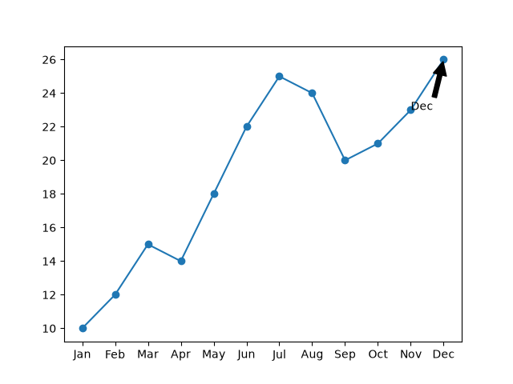
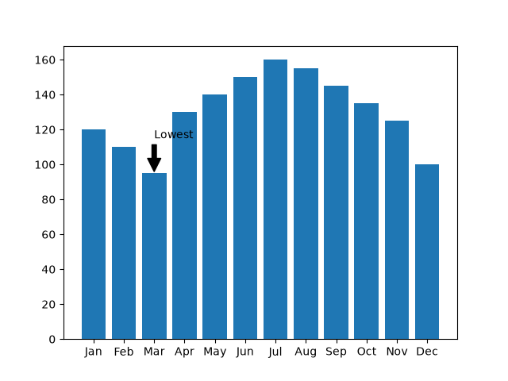
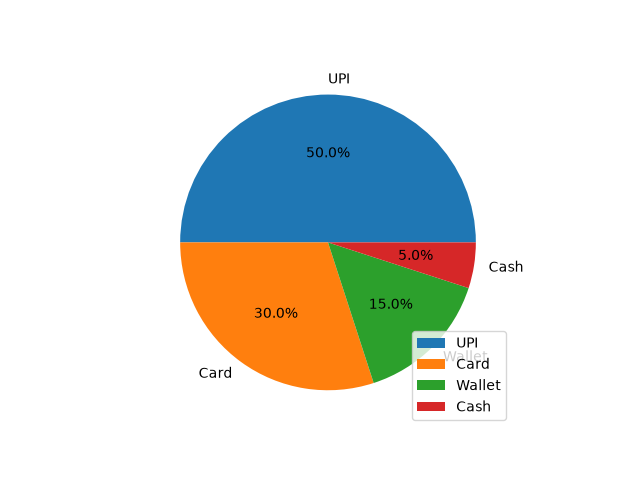
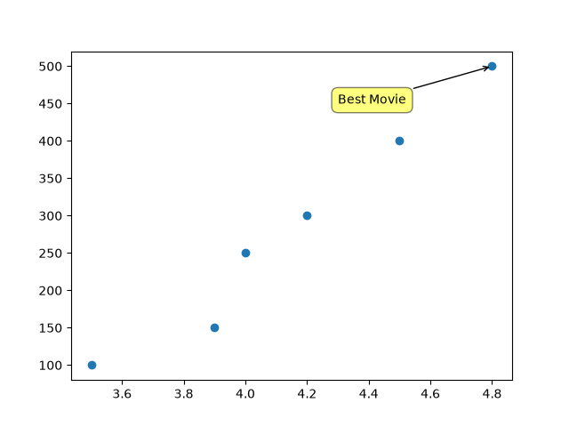

# Task 1
## Create a line chart using Matplotlib to show the number of daily active users for a music streaming app (like Spotify) over 12 months, and use plt.annotate() to label the month with the highest user count.
### Code
```python
import matplotlib.pyplot as plt
months=['Jan','Feb','Mar','Apr','May','Jun','Jul','Aug','Sep','Oct','Nov','Dec']
daily_users=[10,12,15,14,18,22,25,24,20,21,23,26]
plt.plot(months,daily_users,marker='o')
max_idx=daily_users.index(max(daily_users))
plt.annotate(months[max_idx],xy=(max_idx,daily_users[max_idx]),
             xytext=(max_idx-1,daily_users[max_idx]-3),
             arrowprops=dict(facecolor='black',shrink=0.05))
plt.savefig('daily_users.png')
plt.show()
```
### Output


# Task 2
## Plot a bar chart showing the number of orders per month for a food delivery app (like Zomato), and add an arrow annotation using plt.annotate() to highlight the month with the lowest orders.<br><br><em><strong>Hint:</strong> Use the 'arrowprops' parameter to draw the arrow pointing to the bar.</em>
### Code
```python
import matplotlib.pyplot as plt
months=['Jan','Feb','Mar','Apr','May','Jun','Jul','Aug','Sep','Oct','Nov','Dec']
orders=[120,110,95,130,140,150,160,155,145,135,125,100]
plt.bar(months,orders)
min_idx=orders.index(min(orders))
plt.annotate('Lowest',xy=(min_idx,orders[min_idx]),
             xytext=(min_idx,orders[min_idx]+20),
             arrowprops=dict(facecolor='black',shrink=0.05))
plt.savefig('order.png')
plt.show()
```
### Output


# Task 3
## Create a pie chart representing the percentage of different payment methods (UPI, Card, Wallet, Cash) used on an e-commerce app (like Flipkart), and add a legend positioned at the lower right corner of the plot.
### Code
```python
import matplotlib.pyplot as plt
methods=['UPI','Card','Wallet','Cash']
shares=[50,30,15,5]
plt.pie(shares,labels=methods,autopct='%1.1f%%')
plt.legend(loc='lower right')
plt.savefig('payment.png')
plt.show()
```
### Output


# Task 4
## Given a scatter plot of movie ratings vs. number of reviews for movies on a streaming platform (like BookMyShow), use plt.annotate() to add a text box highlighting the movie with the highest rating.<br><br><em><strong>Hint:</strong> Set the 'bbox' parameter in plt.annotate() to create a visible text box.</em>
### Code
```python
import matplotlib.pyplot as plt
ratings=[3.5,4.0,4.2,4.8,3.9,4.5]
reviews=[100,250,300,500,150,400]
plt.scatter(ratings,reviews)
max_idx=ratings.index(max(ratings))
plt.annotate('Best Movie',
             xy=(ratings[max_idx],reviews[max_idx]),
             xytext=(ratings[max_idx]-0.5,reviews[max_idx]-50),
             bbox=dict(boxstyle='round,pad=0.5',fc='yellow',alpha=0.5),
             arrowprops=dict(arrowstyle='->'))
plt.savefig('movie.png')
plt.show()
```
### Output
