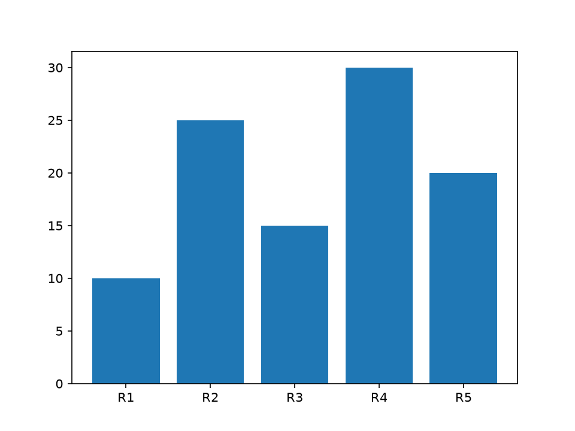
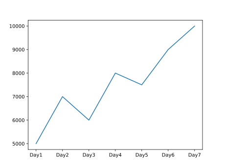
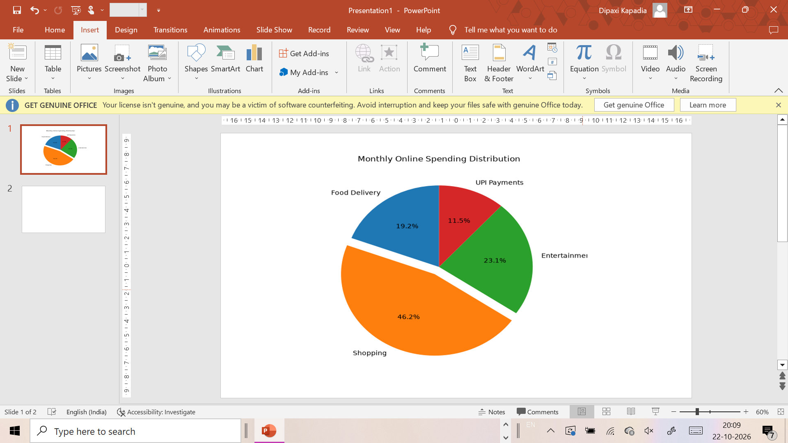

# Task 1
## Create a simple bar chart showing the number of orders for 5 different Zomato restaurants and save the chart as a PNG file using plt.savefig() with a DPI of 150.
### Code
```python
import matplotlib.pyplot as plt
r=['R1','R2','R3','R4','R5']
o=[10,25,15,30,20]
plt.bar(r,o)
plt.savefig('orders.png',dpi=150)
plt.show()
```
### Output


# Task 2
## Generate a line plot that displays your daily step count for one week (7 days) and export it as an SVG file using plt.savefig().<br><br><em><strong>Hint:</strong> Change the file extension in the filename argument to save as SVG.</em>
### Code
```python
import matplotlib.pyplot as plt
d=['Day1','Day2','Day3','Day4','Day5','Day6','Day7']
s=[5000,7000,6000,8000,7500,9000,10000]
plt.plot(d,s)
plt.savefig('steps.svg')
plt.show()
```
### Output


# Task 3
## Build a pie chart showing the percentage of time you spend on 4 different apps (Instagram, YouTube, WhatsApp, Spotify) in a day and save the chart as a PDF using plt.savefig().
### Code
```python
import matplotlib.pyplot as plt
a=['Instagram','YouTube','WhatsApp','Spotify']
t=[40,30,20,10]
plt.pie(t,labels=a)
plt.savefig('apps.pdf')
plt.show()
```
### Output
[View the Project Documentation (PDF)](apps.pdf)

# Task 4
## Take any plot you created above and embed the saved image into a PowerPoint slide using PowerPoint (or Google Slides).<br><br><em><strong>Hint:</strong> Use the Insert > Picture option in PPT to add your exported chart.</em>
### Output


# Task 5
## Export a Matplotlib chart as a PDF, then verify the PDF opens correctly and the chart looks sharp (not blurry) at 200% zoom. If the image looks pixelated, try exporting again with a higher DPI setting and compare the results.
### Code
```python
import matplotlib.pyplot as plt
x=[1,2,3,4,5]
y=[2,4,6,8,10]
plt.plot(x,y)
plt.savefig('chart.pdf',dpi=300)
plt.show()
```
### Output
[View the Project Documentation (PDF)](chart.pdf)
