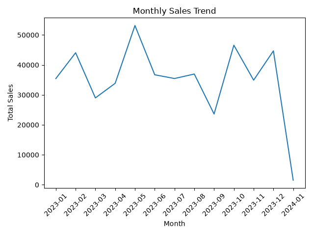
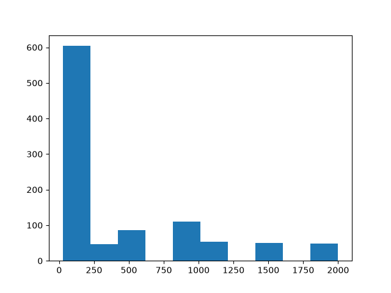
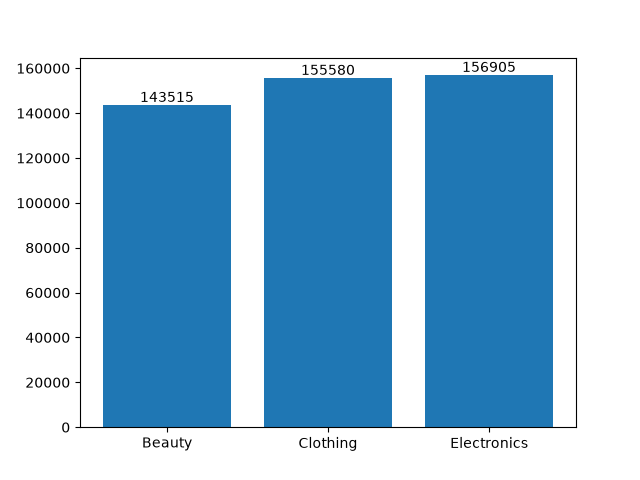

# Task 1
## Download a sample sales dataset (for example, from Kaggle or use a small CSV you create) with columns like product, category, date, and sales amount. Load it into a Pandas DataFrame and display the first 5 rows to verify the data.
### Code
```python
import pandas as pd
df=pd.read_csv('retail_sales_dataset.csv')
print(df.head())
```
### Output
```
   Transaction ID        Date Customer ID  ...  Quantity  Price per Unit  Total Amount
0               1  2023-11-24     CUST001  ...         3              50           150
1               2  2023-02-27     CUST002  ...         2             500          1000
2               3  2023-01-13     CUST003  ...         1              30            30
3               4  2023-05-21     CUST004  ...         1             500           500
4               5  2023-05-06     CUST005  ...         2              50           100
```
<br>
<br>

# Task 2
## Using Matplotlib, create a bar chart that shows total sales for each product category (like 'Electronics', 'Clothing', 'Groceries'), similar to how Flipkart or Myntra might track category performance.
### Code
```python
import pandas as pd
import matplotlib.pyplot as plt
df=pd.read_csv('retail_sales_dataset.csv')
category_sales=df.groupby('Product Category')['Total Amount'].sum()
plt.bar(category_sales.index,category_sales.values)
plt.savefig('category_sales.png')
plt.show()
```
### Output


# Task 3
## Plot a line chart to visualize monthly sales trends over a year, using the date column to group sales by month. Add a title and axis labels to make the chart presentation-ready.
### Code
```python
import pandas as pd
import matplotlib.pyplot as plt
df=pd.read_csv('retail_sales_dataset.csv')
df['Date']=pd.to_datetime(df['Date'])
df['Month']=df['Date'].dt.strftime('%Y-%m')
monthly_sales=df.groupby('Month')['Total Amount'].sum()
plt.plot(monthly_sales.index,monthly_sales.values)
plt.title('Monthly Sales Trend')
plt.xlabel('Month')
plt.ylabel('Total Sales')
plt.xticks(rotation=45)
plt.tight_layout()
plt.savefig('monthly_sales.png')
plt.show()
```
### Output


# Task 4
## Create a histogram to show the distribution of order amounts (sales values), highlighting how many small vs. large purchases happen — like analyzing order size patterns on Zomato or Swiggy.<br><br><em><strong>Hint:</strong> Use plt.hist() and set bins to 10 for a clear distribution.</em>
### Code
```python
import pandas as pd
import matplotlib.pyplot as plt
df=pd.read_csv('retail_sales_dataset.csv')
plt.hist(df['Total Amount'],bins=10)
plt.savefig('order_amounts.png')
plt.show()
```
### Output


# Task 5
### Add value annotations to your category bar chart to display the exact sales amount above each bar, then export the chart as a PNG image file named 'category_sales_kpi.png'.
### Code
```python
import pandas as pd
import matplotlib.pyplot as plt
df=pd.read_csv('retail_sales_dataset.csv')
category_sales=df.groupby('Product Category')['Total Amount'].sum()
bars=plt.bar(category_sales.index,category_sales.values)
plt.bar_label(bars)
plt.savefig('category_sales_kpi.png')
plt.show()
```
### Output
