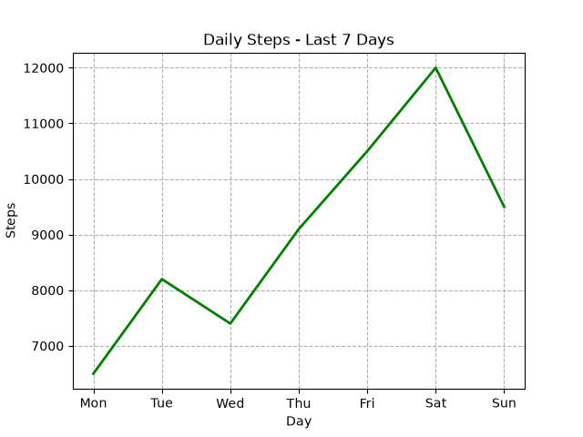
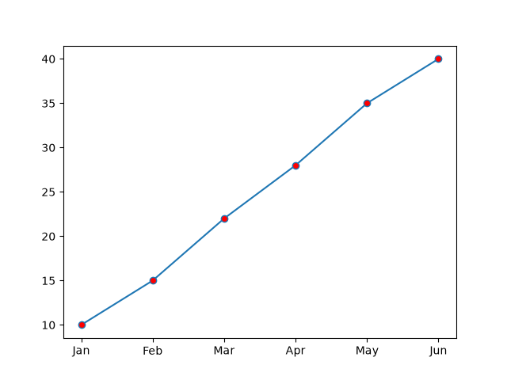
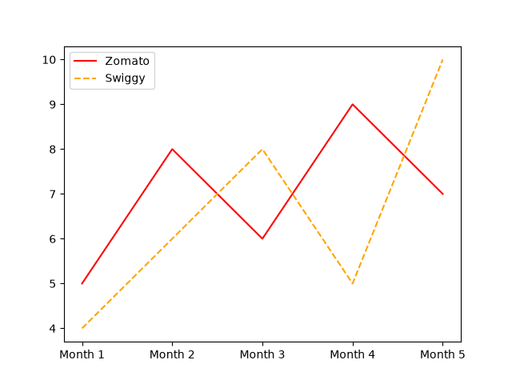
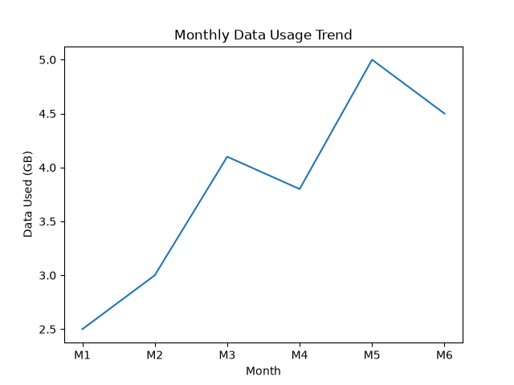

# Task 1
## Use plt.plot() to create a line chart showing the number of daily steps you walked over the last 7 days. Set the line color to green and linewidth to 2.
### Code
```python
import matplotlib.pyplot as plt
days=['Mon','Tue','Wed','Thu','Fri','Sat','Sun']
steps=[6500,8200,7400,9100,10500,12000,9500]
plt.plot(days,steps,color='green',linewidth=2)

plt.xlabel('Day')
plt.ylabel('Steps')
plt.title('Daily Steps - Last 7 Days')
plt.grid(True, linestyle='--')

plt.savefig('daily_steps.png')

plt.show()
```
### Output

<br>
<br>

# Task 2
## Plot a line chart of your favorite music app's monthly active users for 6 months using plt.plot(). Add circle markers at each data point and set the marker color to red.<br><br><em><strong>Hint:</strong> Use the marker and markerfacecolor parameters in plt.plot().</em>
### Code
```python
import matplotlib.pyplot as plt
months=['Jan','Feb','Mar','Apr','May','Jun']
users=[10,15,22,28,35,40]
plt.plot(months, users, marker='o', markerfacecolor='red')
plt.savefig('music_app_users.png')
```
### Output


# Task 3
## Create a line chart comparing the number of orders you placed on Zomato and Swiggy over the last 5 months. Use different line styles and colors for each app, and add a legend to distinguish them.
### Code
```python
import matplotlib.pyplot as plt
months=['Month 1','Month 2','Month 3','Month 4','Month 5']
zomato_orders=[5,8,6,9,7]
swiggy_orders=[4,6,8,5,10]

plt.plot(months,zomato_orders,color='red',linestyle='-',label='Zomato')
plt.plot(months,swiggy_orders,color='orange',linestyle='--',label='Swiggy')
plt.legend()
plt.savefig('food_orders_comparison.png')
plt.show()
```
### Output

<br>
<br>

# Task 4
## Add a main title 'Monthly Data Usage Trend' and label the X-axis as 'Month' and Y-axis as 'Data Used (GB)' to a line chart showing your mobile data usage for the past 6 months.<br><br><em><strong>Hint:</strong> Use plt.title(), plt.xlabel(), and plt.ylabel().</em>
### Code
```python
import matplotlib.pyplot as plt
months=['M1','M2','M3','M4','M5','M6']
data_used=[2.5,3.0,4.1,3.8,5.0,4.5]

plt.plot(months, data_used)
plt.title('Monthly Data Usage Trend')
plt.xlabel('Month')
plt.ylabel('Data Used (GB)')
plt.savefig('data_usage_trend.png')
plt.show()
```
### Output
