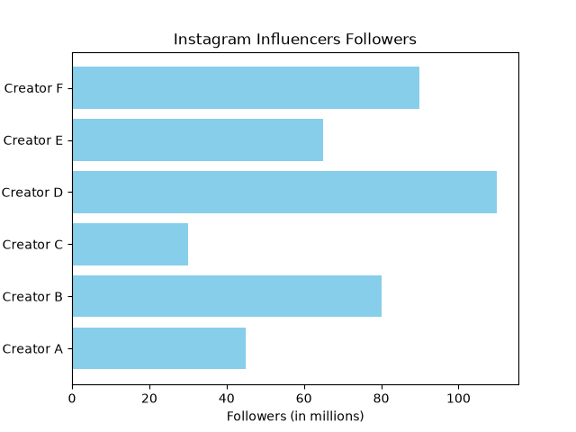
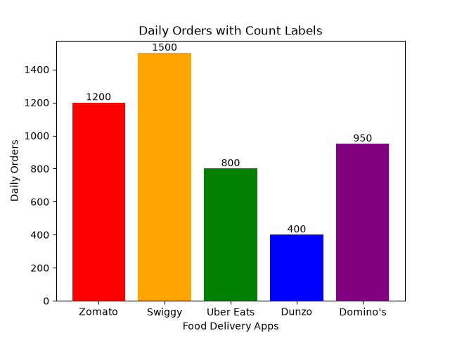
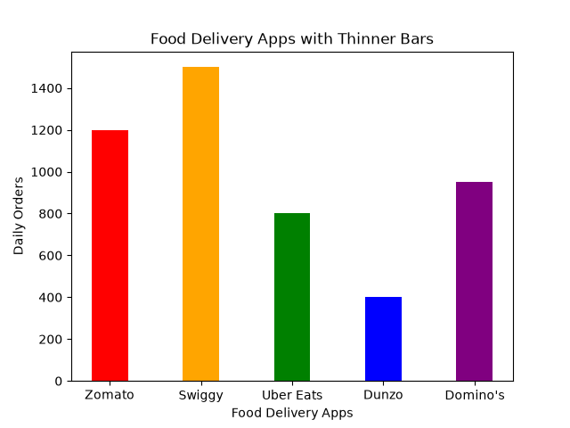

# Task 1
## Use plt.bar() to create a vertical bar chart showing the number of daily orders for 5 popular food delivery apps (e.g., Zomato, Swiggy, Uber Eats, Dunzo, Domino's) and set a custom color for each bar.
### Code
```python
import matplotlib.pyplot as plt
apps=['Zomato','Swiggy','Uber Eats','Dunzo',"Domino's"]
orders=[1200,1500,800,400,950]
colors=['red','orange','green','blue','purple']

plt.bar(apps,orders,color=colors)
plt.xlabel('Food Delivery Apps')
plt.ylabel('Daily Orders')
plt.title('Daily Orders for Food Delivery Apps')

plt.savefig('daily_orders.png')
plt.show()
```
### Output

<br>\
<br>

# Task 2
## Create a horizontal bar chart using plt.barh() to display the number of followers for 6 different Instagram influencers; add a title and label the x-axis as 'Followers (in millions)'.
### Code
```python
import matplotlib.pyplot as plt
influencers=['Creator A','Creator B','Creator C','Creator D','Creator E','Creator F']
followers=[45,80,30,110,65,90]

plt.barh(influencers,followers,color='skyblue')
plt.xlabel('Followers (in millions)')
plt.ylabel('Influencers')
plt.title('Instagram Influencers Followers')

plt.savefig('Influencers.png')
plt.show()
```
### Output

<br>
<br>

# Task 3
## Modify your vertical bar chart to display the exact order count as a text label above each bar using plt.text().<br><br><em><strong>Hint:</strong> Use a for loop to iterate through the bars and place the text labels at the correct height.</em>
### Code
```python
import matplotlib.pyplot as plt
apps=['Zomato','Swiggy','Uber Eats','Dunzo',"Domino's"]
orders=[1200,1500,800,400,950]
colors=['red','orange','green','blue','purple']

bars=plt.bar(apps,orders,color=colors)
for bar in bars:
    height=bar.get_height()
    plt.text(bar.get_x()+bar.get_width()/2,height,str(height),
            ha='center',va='bottom')

plt.xlabel('Food Delivery Apps')
plt.ylabel('Daily Orders')
plt.title('Daily Orders with Count Labels')

plt.savefig('bar.png')
plt.show()
```
### Output

<br>
<br>

# Task 4
## Change the width of the bars in your food delivery app chart to make them thinner, and adjust the spacing so the bars do not overlap.<br><br><em><strong>Constraint:</strong> Use the 'width' parameter in plt.bar() and experiment with values less than 0.8.</em>
### Code
```python
import matplotlib.pyplot as plt
apps=['Zomato','Swiggy','Uber Eats','Dunzo',"Domino's"]
orders=[1200,1500,800,400,950]
colors=['red','orange','green','blue','purple']

plt.bar(apps,orders,width=0.4,color=colors)

plt.xlabel('Food Delivery Apps')
plt.ylabel('Daily Orders')
plt.title('Food Delivery Apps with Thinner Bars')

plt.savefig('width.png')
plt.show()
```
### Output
