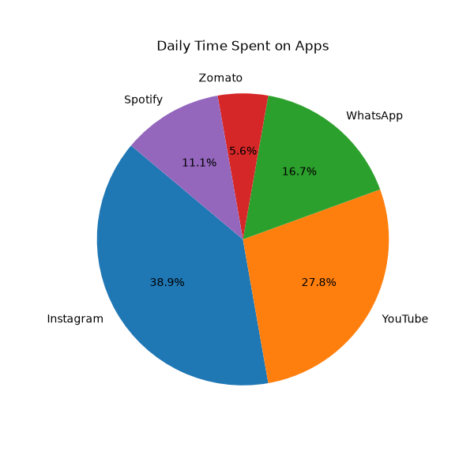
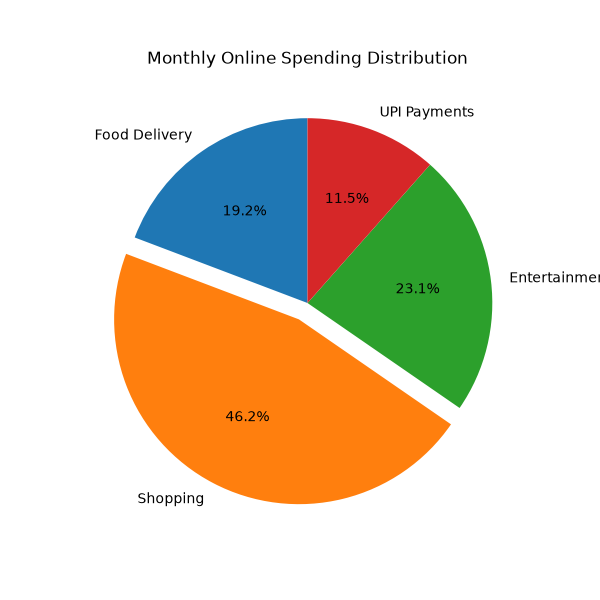
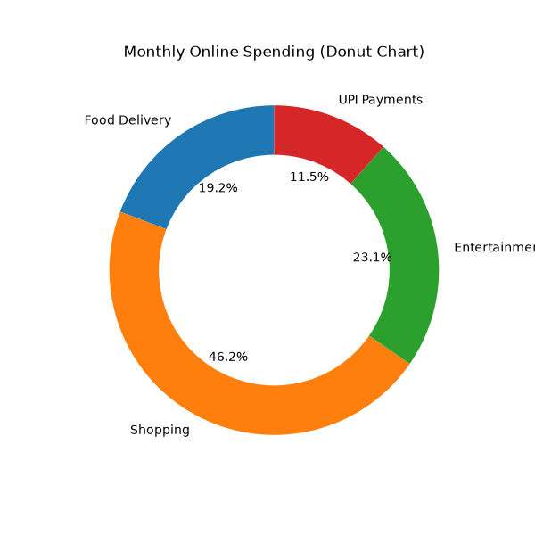
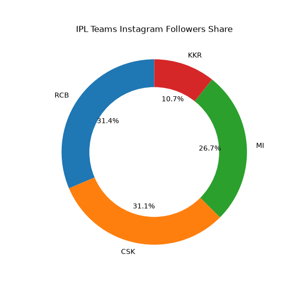

# Task 1
## Use plt.pie() to visualize the percentage of time you spend on 5 different apps in a day (e.g., Instagram, YouTube, WhatsApp, Zomato, Spotify) and display the percentage values on each segment using the autopct parameter.
### Code
```python
import matplotlib.pyplot as plt
apps=['Instagram','YouTube','WhatsApp','Zomato','Spotify']
hours=[3.5,2.5,1.5,0.5,1.0]

plt.figure(figsize=(6,6))
plt.pie(hours,labels=apps,autopct='%1.1f%%',startangle=140)
plt.title('Daily Time Spent on Apps')

plt.savefig('app_usage.png')
plt.show()
```
### Output

<br>
<br>

# Task 2
## Create a pie chart showing the distribution of your monthly online spending across 4 categories: Food Delivery, Shopping, Entertainment, and UPI Payments, and use the explode parameter to highlight the category with the highest spending.<br><br><em><strong>Hint:</strong> Set a higher explode value for the segment you want to pull out from the pie.</em>
### Code
```python
import matplotlib.pyplot as plt
categories=['Food Delivery','Shopping','Entertainment','UPI Payments']
spending=[2500,6000,3000,1500]

explode=(0, 0.1, 0, 0)

plt.figure(figsize=(6,6))
plt.pie(
    spending,
    labels=categories,
    autopct='%1.1f%%',
    explode=explode,
    startangle=90,
)
plt.title('Monthly Online Spending Distribution')

plt.savefig('spending_pie.png')
plt.show()
```
### Output

<br>
<br>

# Task 3
## Transform your pie chart into a donut chart to show the same spending data by adding a white circle at the center using plt.Circle and ax.add_artist.
### Code
```python
import matplotlib.pyplot as plt
categories=['Food Delivery','Shopping','Entertainment','UPI Payments']
spending=[2500,6000,3000,1500]

fig,ax=plt.subplots(figsize=(6,6))
ax.pie(spending,labels=categories,autopct='%1.1f%%',startangle=90)

centre_circle=plt.Circle((0,0),0.70,fc='white')
ax.add_artist(centre_circle)

plt.title('Monthly Online Spending (Donut Chart)')

plt.savefig('spending_donut.png')
plt.show()
```
### Output

<br>
<br>

# Task 4
## Suppose you want to compare the market share of 4 IPL cricket teams based on the number of Instagram followers. Build a donut chart where each segment shows the team name and follower percentage, and the chart title clearly states 'IPL Teams Instagram Followers Share'.<br><br><em><strong>Constraint:</strong> Use both labels and autopct to display information on the chart.</em>
### Code
```python
import matplotlib.pyplot as plt
teams=['RCB','CSK','MI','KKR']
followers=[22.9,22.7,19.5,7.8]

fig,ax=plt.subplots(figsize=(6,6))
ax.pie(followers,labels=teams,autopct='%1.1f%%',startangle=90)

centre_circle=plt.Circle((0,0),0.70,fc='white')
ax.add_artist(centre_circle)

plt.title('IPL Teams Instagram Followers Share')

plt.savefig('ipl_donut.png')
plt.show()
```
### Output
