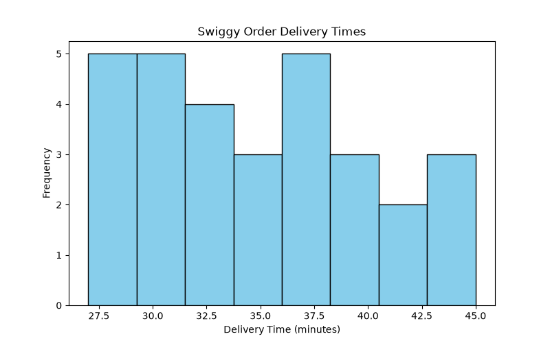
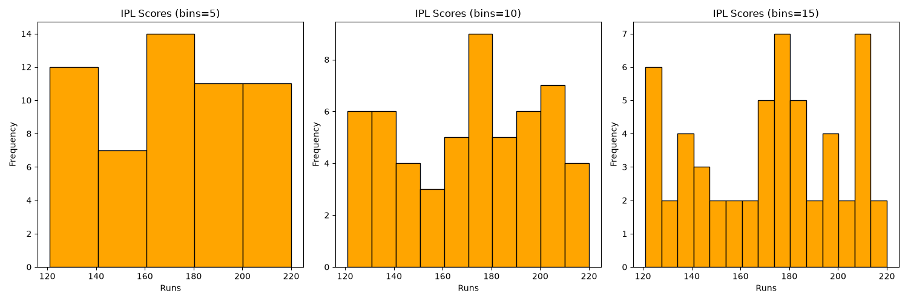
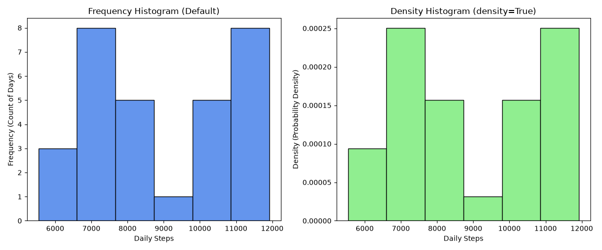
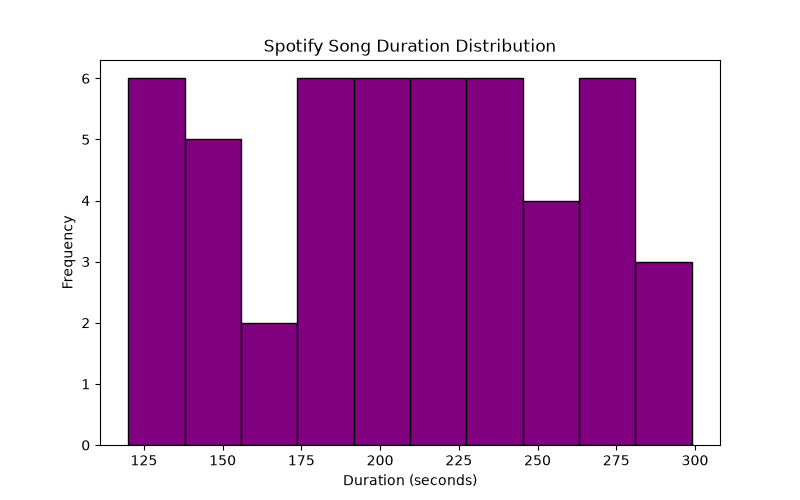
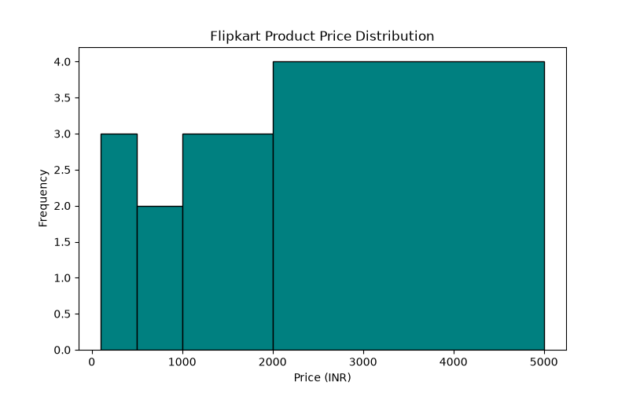

# Task 1
## Use plt.hist() to plot a histogram of delivery times (in minutes) for 30 Swiggy orders: [32, 28, 45, 30, 36, 40, 29, 34, 38, 31, 27, 41, 33, 35, 39, 37, 44, 30, 29, 32, 36, 28, 43, 31, 35, 40, 38, 33, 30, 42]. Show the plot window.
### Code
```python
import matplotlib.pyplot as plt
delivery_times=[32,28,45,30,36,40,29,34,38,31,27,41,33,35,39,
                  37,44,30,29,32,36,28,43,31,35,40,38,33,30,42]

plt.figure(figsize=(8,5))
plt.hist(delivery_times,bins=8,edgecolor="black",color="skyblue")
plt.xlabel("Delivery Time (minutes)")
plt.ylabel("Frequency")
plt.title("Swiggy Order Delivery Times")
plt.savefig("swiggy_delivery_histogram.png")
plt.show()
```
### Output

<br>
<br>

# Task 2
## Plot a histogram of IPL match scores (runs per team in a match) using plt.hist() and experiment with bins=5, bins=10, and bins=15. Observe and describe how changing the number of bins affects the shape of the histogram.<br><br><em><strong>Hint:</strong> Use any sample array of 50-60 scores between 120 and 220.</em>
### Code
```python
import matplotlib.pyplot as plt
import numpy as np
np.random.seed(42)
ipl_scores=np.random.randint(120,221,size=55)

fig, axes=plt.subplots(1,3,figsize=(15,5))
bins_list=[5,10,15]

for i,b in enumerate(bins_list):
  axes[i].hist(ipl_scores,bins=b,edgecolor="black",color="orange")
  axes[i].set_title(f"IPL Scores (bins={b})")
  axes[i].set_xlabel("Runs")
  axes[i].set_ylabel("Frequency")

plt.tight_layout()
plt.savefig("ipl_scores_bins_comparison.png")
plt.show()

# Observation:
# bins=5: groups the scores broadly.
# bins=10: provides a balanced view.
# bins=15: increases granularity, exposing peaks and valleys, but can make the histogram look noisy.
```
### Output

<br>
<br>

# Task 3
## Given an array of daily step counts from a fitness tracker app for one month, plot two histograms using plt.hist(): one showing frequency (default), and one showing density=True. Compare the y-axis labels and explain the difference.
### Code
```python
import matplotlib.pyplot as plt
import numpy as np
np.random.seed(0)
step_counts=np.random.randint(5000,12000,size=30)

fig,(ax1,ax2)=plt.subplots(1,2,figsize=(12,5))

ax1.hist(step_counts,bins=6,edgecolor="black",color="cornflowerblue")
ax1.set_title("Frequency Histogram (Default)")
ax1.set_xlabel("Daily Steps")
ax1.set_ylabel("Frequency (Count of Days)")

ax2.hist(step_counts,bins=6,density=True,edgecolor="black",color="lightgreen")
ax2.set_title("Density Histogram (density=True)")
ax2.set_xlabel("Daily Steps")
ax2.set_ylabel("Density (Probability Density)")

plt.tight_layout()
plt.savefig("step_counts_histogram_comparison.png")
plt.show()

# Explanation of Y-Axis Difference:
# Frequency: shows the raw count of days falling into each step interval.
# Density: normalizes the total area of the bars to 1, representing probability density instead of absolute counts.
```
### Output

<br>
<br>

# Task 4
## Simulate the distribution of song durations (in seconds) from your Spotify playlist by generating 50 random numbers between 120 and 300. Plot a histogram using plt.hist() and set the color to 'purple' and add the title 'Spotify Song Duration Distribution'.
### Code
```python
import matplotlib.pyplot as plt
import numpy as np
np.random.seed(10)
song_durations=np.random.randint(120,301,size=50)

plt.figure(figsize=(8,5))
plt.hist(song_durations,bins=10,color="purple",edgecolor="black")
plt.title("Spotify Song Duration Distribution")
plt.xlabel("Duration (seconds)")
plt.ylabel("Frequency")
plt.savefig("spotify_song_durations.png")
plt.show()
```
### Output

<br>
<br>

# Task 5
## You are given a histogram code that plots Flipkart product prices, but the bins are not showing expected groupings. Debug the code by adjusting the bins parameter so that prices between 100-500, 501-1000, 1001-2000, and 2001-5000 are each in their own bin.<br><br><em><strong>Hint:</strong> Use the 'bins' parameter with a list of bin edges.</em>
### Code
```python
import matplotlib.pyplot as plt
product_prices=[250,450,800,1200,1500,2200,
                4500,300,950,1100,2500,4900]
bin_edges=[100,501,1001,2001,5001]

plt.figure(figsize=(8,5))
plt.hist(product_prices,bins=bin_edges,edgecolor="black",color="teal")
plt.title("Flipkart Product Price Distribution")
plt.xlabel("Price (INR)")
plt.ylabel("Frequency")
plt.savefig("flipkart_product_prices.png")
plt.show()
```
### Output
