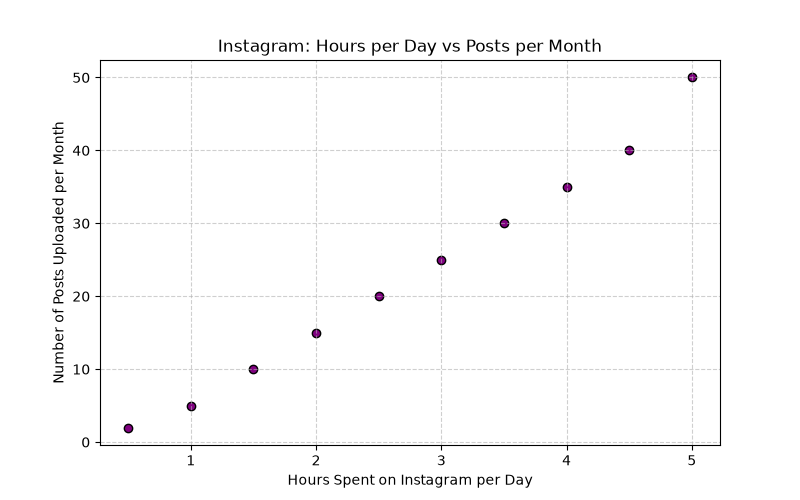
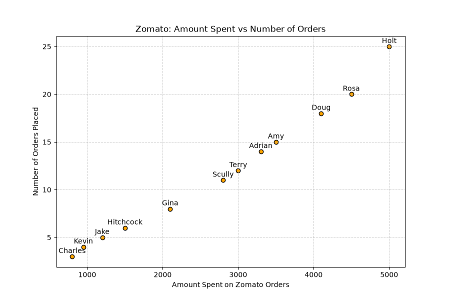
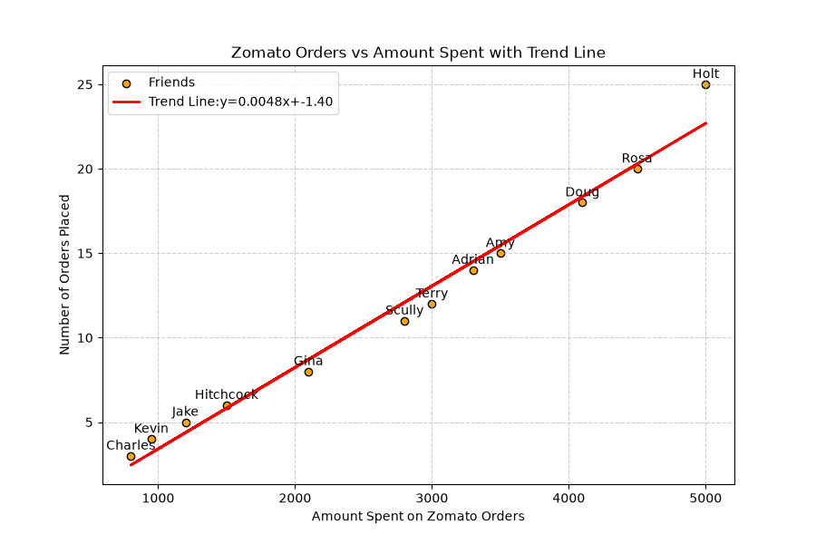
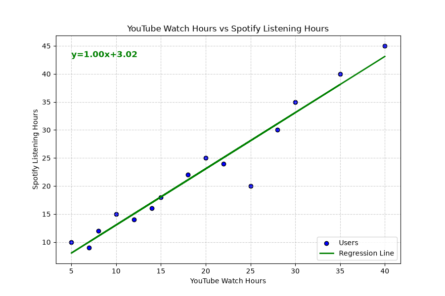
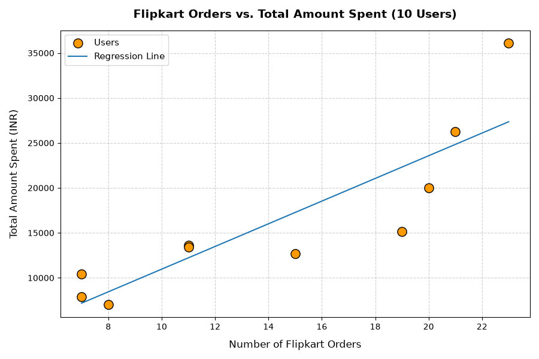

# Task 1
## Use plt.scatter() to plot a graph of 'hours spent on Instagram per day' vs 'number of posts uploaded per month' for at least 10 fictional users.
### Code
```python
import matplotlib.pyplot as plt
hours_on_ig=[1.5,3.0,0.5,4.5,2.0,3.5,1.0,5.0,2.5,4.0]
posts_per_month=[10,25,2,40,15,30,5,50,20,35]

plt.figure(figsize=(8,5))
plt.scatter(hours_on_ig,posts_per_month,color='purple',edgecolor='black')
plt.title('Instagram: Hours per Day vs Posts per Month')
plt.xlabel('Hours Spent on Instagram per Day')
plt.ylabel('Number of Posts Uploaded per Month')
plt.grid(True, linestyle='--', alpha=0.6)

plt.savefig('instagram_scatter.png')
plt.show()
```
### Output

<br>
<br>

# Task 2
## Create a scatter plot showing 'amount spent on Zomato orders' vs 'number of orders placed' for 12 friends, and label each point with the friend's name.<br><br><em><strong>Hint:</strong> Use the 'annotate' function in matplotlib to add labels.</em>
### Code
```python
import matplotlib.pyplot as plt
friends=['Jake','Amy','Charles','Rosa','Gina','Terry', 
           'Kevin','Holt','Hitchcock','Scully','Doug','Adrian']
amount_spent=[1200,3500,800,4500,2100,3000,950,5000,1500,2800,4100,3300]
orders_placed=[5,15,3,20,8,12,4,25,6,11,18,14]

plt.figure(figsize=(9,6))
plt.scatter(amount_spent,orders_placed,color='orange',edgecolor='black')

for i,name in enumerate(friends):
    plt.annotate(name,(amount_spent[i],orders_placed[i]), 
                textcoords="offset points",xytext=(0, 5),ha='center')

plt.title('Zomato: Amount Spent vs Number of Orders')
plt.xlabel('Amount Spent on Zomato Orders')
plt.ylabel('Number of Orders Placed')
plt.grid(True, linestyle='--', alpha=0.6)

plt.savefig('zomato_labeled_scatter.png')
plt.show()
```
### Output

<br>
<br>

# Task 3
## Add a trend line to your Zomato scatter plot by calculating the best-fit line using numpy's polyfit(), then plot it on top of the scatter plot.<br><br><em><strong>Hint:</strong> Use np.polyfit() to get the slope and intercept, then plot the line with plt.plot().</em>
### Code
```python
import matplotlib.pyplot as plt
import numpy as np
friends=['Jake','Amy','Charles','Rosa','Gina','Terry', 
           'Kevin','Holt','Hitchcock','Scully','Doug','Adrian']
amount_spent=np.array([1200,3500,800,4500,2100,3000,950,5000,1500,2800,4100,3300])
orders_placed=np.array([5,15,3,20,8,12,4,25,6,11,18,14])

slope, intercept=np.polyfit(amount_spent,orders_placed,1)
trend_line=slope*amount_spent+intercept

plt.figure(figsize=(9,6))
plt.scatter(amount_spent,orders_placed,color='orange',edgecolor='black',label='Friends')
plt.plot(amount_spent,trend_line,color='red',linewidth=2, 
         label=f'Trend Line:y={slope:.4f}x+{intercept:.2f}')

for i,name in enumerate(friends):
    plt.annotate(name,(amount_spent[i],orders_placed[i]), 
                 textcoords="offset points",xytext=(0,5),ha='center')

plt.title('Zomato Orders vs Amount Spent with Trend Line')
plt.xlabel('Amount Spent on Zomato Orders')
plt.ylabel('Number of Orders Placed')
plt.legend()
plt.grid(True, linestyle='--', alpha=0.6)

plt.savefig('zomato_trend_line.png')
plt.show()
```
### Output

<br>
<br>

# Task 4
## Given a dataset of 'YouTube watch hours' and 'Spotify listening hours' for 15 users, use numpy polyfit to fit a regression line, plot both the scatter and the trend line, and print the equation of the line on the plot.
### Code
```python
import matplotlib.pyplot as plt
import numpy as np
youtube_hours=np.array([10,25,5,30,15,20,8,35,12,18,28,22,14,7,40])
spotify_hours=np.array([15,20,10,35,18,25,12,40,14,22,30,24,16,9,45])

slope, intercept=np.polyfit(youtube_hours,spotify_hours,1)
regression_line=slope*youtube_hours+intercept

plt.figure(figsize=(9,6))
plt.scatter(youtube_hours,spotify_hours,color='blue',edgecolor='black',label='Users')
plt.plot(youtube_hours,regression_line,color='green',linewidth=2,label='Regression Line')

equation_text=f'y={slope:.2f}x+{intercept:.2f}'
plt.text(min(youtube_hours),max(spotify_hours)-2,equation_text,fontsize=12,color='green',fontweight='bold')

plt.title('YouTube Watch Hours vs Spotify Listening Hours')
plt.xlabel('YouTube Watch Hours')
plt.ylabel('Spotify Listening Hours')
plt.legend()
plt.grid(True, linestyle='--', alpha=0.6)

plt.savefig('youtube_spotify_regression.png')
plt.show()
```
### Output

<br>
<br>

# Task 5
## Use ChatGPT or Copilot to generate Python code that creates a scatter plot of 'number of Flipkart orders' vs 'total amount spent' for 10 users, adds a regression line using numpy polyfit, and displays the plot. Run the generated code and note any errors or changes you had to make.
### Code
```python
import numpy as np
import matplotlib.pyplot as plt

# Set a random seed for reproducibility
np.random.seed(42)

# 1. Generate mock data for 10 users
# Number of Flipkart orders (ranging between 1 and 25)
num_orders = np.random.randint(1, 26, size=10)

# Total amount spent (correlated with orders plus some realistic variance)
total_spent = num_orders * np.random.uniform(800, 1500, size=10) + np.random.normal(0, 1500, size=10)
total_spent = np.maximum(total_spent, 500) # Ensure values are positive

# 2. Calculate the regression line using numpy polyfit (degree 1 for linear fit)
m, c = np.polyfit(num_orders, total_spent, 1)

# 3. Create the scatter plot and regression line
plt.figure(figsize=(9, 6))

# Scatter plot for users
plt.scatter(num_orders, total_spent, color='#FF9900', edgecolor='black', s=120, zorder=3, label='Users')
# without sorting
#plt.plot(num_orders, m * num_orders + c, label='Regression Line')
# adjustment (with sorting)
sorted_indices = np.argsort(num_orders)
x_sorted = num_orders[sorted_indices]
plt.plot(x_sorted, m * x_sorted + c, label='Regression Line')

# 4. Styling and labels
plt.title('Flipkart Orders vs. Total Amount Spent (10 Users)', fontsize=14, fontweight='bold', pad=15)
plt.xlabel('Number of Flipkart Orders', fontsize=12, labelpad=10)
plt.ylabel('Total Amount Spent (INR)', fontsize=12, labelpad=10)

plt.grid(True, linestyle='--', alpha=0.6, zorder=1)
plt.legend(fontsize=11)
plt.tight_layout()

plt.savefig('flipkart_chatgpt.png')
plt.show()
```
### Output
