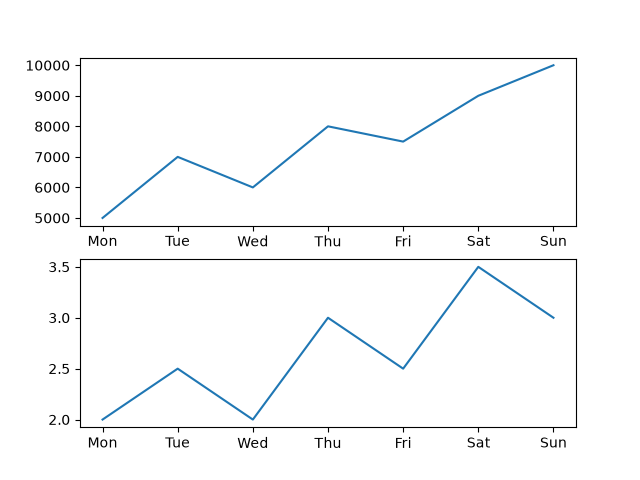
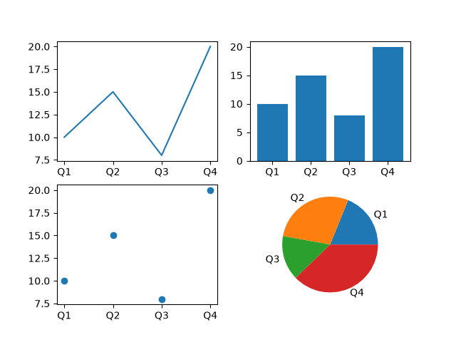
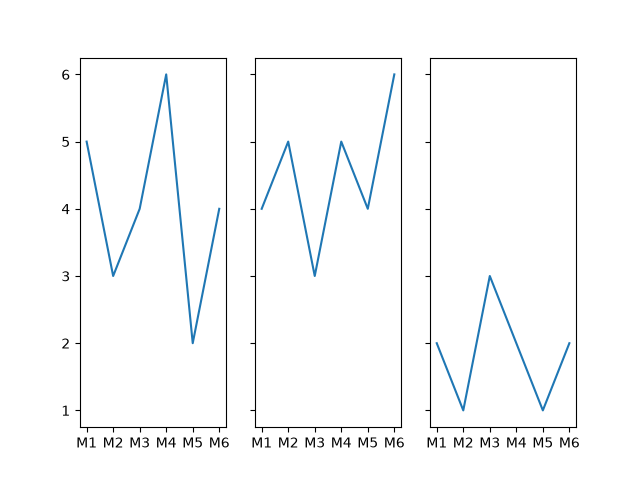
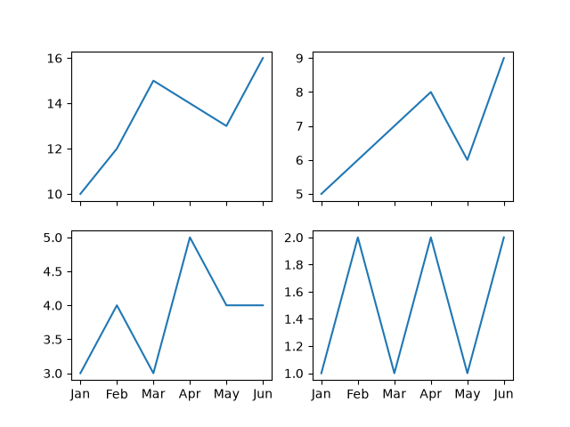

# Task 1
## Use plt.subplot() to create a figure with 2 rows and 1 column of plots showing your daily step count and water intake (in litres) for the last 7 days. Plot both as line charts, one in each subplot.
### Code
```python
import matplotlib.pyplot as plt
days=['Mon','Tue','Wed','Thu','Fri','Sat','Sun']
steps=[5000,7000,6000,8000,7500,9000,10000]
water=[2.0,2.5,2.0,3.0,2.5,3.5,3.0]

plt.figure()
plt.subplot(2,1,1)
plt.plot(days,steps)
plt.subplot(2,1,2)
plt.plot(days,water)
plt.savefig('step_water.png')
plt.show()
```
### Output


# Task 2
## Create a 2x2 multi-panel figure using plt.subplots(). In each subplot, display the number of Instagram posts you made in each quarter (Q1, Q2, Q3, Q4) for the past year, using different chart types: line, bar, scatter, and pie.
### Code
```python
import matplotlib.pyplot as plt
q=['Q1','Q2','Q3','Q4']
p=[10,15,8,20]

fig,axs=plt.subplots(2,2)
axs[0,0].plot(q,p)
axs[0,1].bar(q,p)
axs[1,0].scatter(q,p)
axs[1,1].pie(p,labels=q)
plt.savefig('instagram_posts.png')
plt.show()
```
### Output


# Task 3
## Make a grid of 1 row and 3 columns using plt.subplots(), and plot the number of food orders you placed on Zomato, Swiggy, and Domino's over the last 6 months, one app per subplot. Share the y-axis among all subplots so you can easily compare order counts across apps.<br><br><em><strong>Hint:</strong> Use the 'sharey' parameter in plt.subplots().</em>
### Code
```python
import matplotlib.pyplot as plt
m=['M1','M2','M3','M4','M5','M6']
z=[5,3,4,6,2,4]
s=[4,5,3,5,4,6]
d=[2,1,3,2,1,2]
fig,axs=plt.subplots(1,3,sharey=True)
axs[0].plot(m,z)
axs[1].plot(m,s)
axs[2].plot(m,d)
plt.savefig('food_orders.png')
plt.show()
```
### Output


# Task 4
## Arrange a 2x2 grid of subplots using plt.subplots() to visualize your monthly mobile data usage (in GB) for four different apps: YouTube, Instagram, Spotify, and WhatsApp. Ensure all subplots share the same x-axis (months) for easy comparison.<br><br><em><strong>Hint:</strong> Use the 'sharex' parameter in plt.subplots().</em>
### Code
```python
import matplotlib.pyplot as plt
m=['Jan','Feb','Mar','Apr','May','Jun']
yt=[10,12,15,14,13,16]
ig=[5,6,7,8,6,9]
sp=[3,4,3,5,4,4]
wa=[1,2,1,2,1,2]

fig,axs=plt.subplots(2,2,sharex=True)
axs[0,0].plot(m,yt)
axs[0,1].plot(m,ig)
axs[1,0].plot(m,sp)
axs[1,1].plot(m,wa)
plt.savefig('mobile_data.png')
plt.show()
```
### Output
