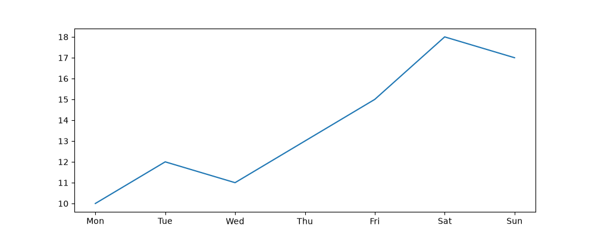
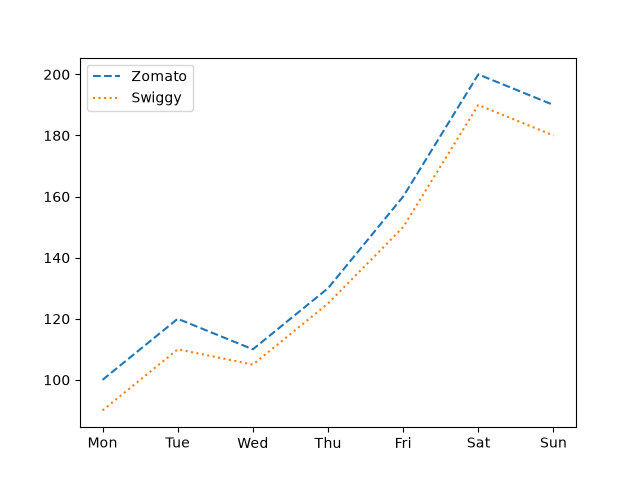
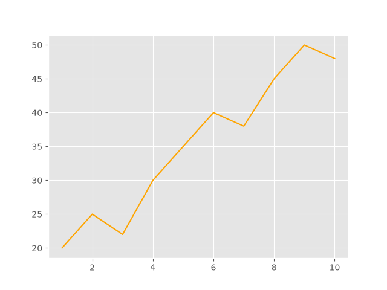
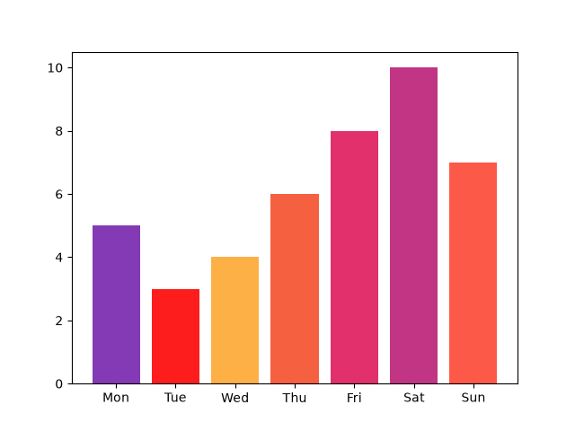
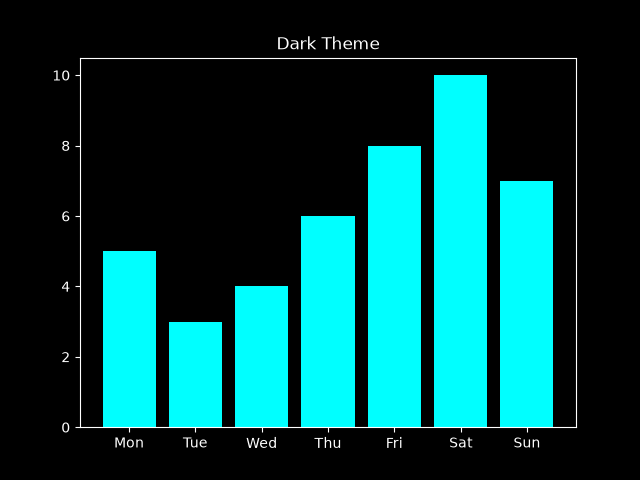

# Task 1
## Create a line chart showing the number of daily active users on a music streaming app (like Spotify) over 7 days, and set the figure size to 10 inches wide by 4 inches tall using plt.figure().
### Code
```python
import matplotlib.pyplot as plt
plt.figure(figsize=(10,4))
plt.plot(['Mon','Tue','Wed','Thu','Fri','Sat','Sun'],[10,12,11,13,15,18,17])
plt.savefig('spotify_daily.png')
plt.show()
```
### Output


# Task 2
## Plot two lines on the same graph representing the number of food orders on Zomato and Swiggy over a week, using different line styles (e.g., dashed for Zomato, dotted for Swiggy) and add a legend to distinguish them.
### Code
```python
import matplotlib.pyplot as plt
days=['Mon','Tue','Wed','Thu','Fri','Sat','Sun']
zomato=[100,120,110,130,160,200,190]
swiggy=[90,110,105,125,150,190,180]

plt.plot(days,zomato,linestyle='--',label='Zomato')
plt.plot(days,swiggy,linestyle=':',label='Swiggy')
plt.legend()
plt.savefig('zomato_swiggy.png')
plt.show()
```
### Output


# Task 3
## Apply the 'ggplot' style to a chart showing Flipkart's daily sales for 10 days using plt.style.use('ggplot'), and customize the line color to orange.
### Code
```python
import matplotlib.pyplot as plt
plt.style.use('ggplot')
plt.plot(range(1,11),[20,25,22,30,35,40,38,45,50,48],color='orange')
plt.savefig('flipkart_orders.png')
plt.show()
```
### Output


# Task 4
## Choose a color palette that matches Instagram's branding and plot a bar chart showing the number of posts uploaded each day for a week; use those colors for the bars.<br><br><em><strong>Hint:</strong> You can use a list of hex color codes to set bar colors.</em>
### Code
```python
import matplotlib.pyplot as plt
days=['Mon','Tue','Wed','Thu','Fri','Sat','Sun']
posts=[5,3,4,6,8,10,7]
colors=['#833ab4','#fd1d1d','#fcb045','#f56040','#e1306c','#c13584','#fd5949']
plt.bar(days,posts,color=colors)
plt.savefig('insta_posts.png')
plt.show()
```
### Output


# Task 5
## Take any one of your previous charts and restyle it to match a dark theme using plt.style.use('dark_background'), then adjust the line or bar colors so that all text and data remain clearly visible.<br><br><em><strong>Constraint:</strong> Do not use the same colors as in the original chart.</em>
### Code
```python
import matplotlib.pyplot as plt
import matplotlib.pyplot as plt
days=['Mon','Tue','Wed','Thu','Fri','Sat','Sun']
posts=[5,3,4,6,8,10,7]
colors=['#833ab4','#fd1d1d','#fcb045','#f56040','#e1306c','#c13584','#fd5949']
plt.bar(days,posts,color=colors)
plt.savefig('light_chart.png')
plt.show()
plt.style.use('dark_background')
plt.bar(days,posts,color='cyan')
plt.savefig('dark_theme_chart.png')
plt.show()
```
### Output


