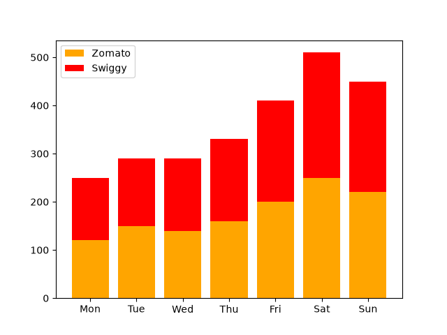
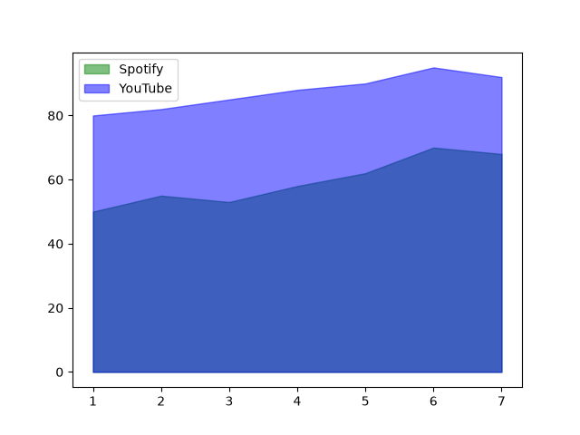
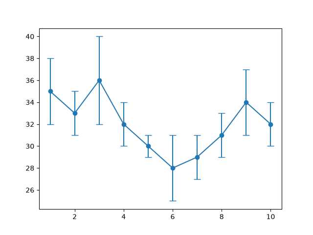
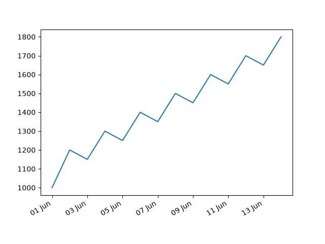
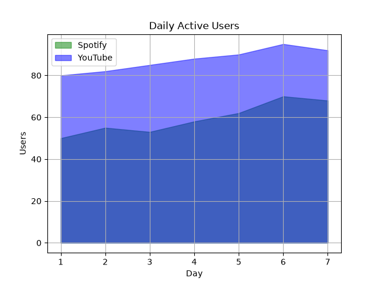

# Task 1
## Create a stacked bar chart using Matplotlib that shows the number of food orders from Zomato and Swiggy for each day of the week. Use different colors for each platform and add a legend.
### Code
```python
import matplotlib.pyplot as plt
days=['Mon','Tue','Wed','Thu','Fri','Sat','Sun']
zomato=[120,150,140,160,200,250,220]
swiggy=[130,140,150,170,210,260,230]

plt.bar(days,zomato,label='Zomato',color='orange')
plt.bar(days,swiggy,bottom=zomato,label='Swiggy',color='red')
plt.legend()
plt.savefig('zomato_&_swiggy_orders.png')
plt.show()
```
### Output


# Task 2
## Plot an area chart that visualizes the daily active users on Spotify and YouTube over a 7-day period using Matplotlib's fill_between(). Make sure each platform's area is filled with a different color and add labels for clarity.
### Code
```python
import matplotlib.pyplot as plt
days=[1,2,3,4,5,6,7]
spotify=[50,55,53,58,62,70,68]
youtube=[80,82,85,88,90,95,92]

plt.fill_between(days,spotify,color='green',alpha=0.5,label='Spotify')
plt.fill_between(days,youtube,color='blue',alpha=0.5,label='YouTube')
plt.legend()
plt.savefig('spotify_youtube_users.png')
plt.show()
```
### Output


# Task 3
## Simulate the average delivery time (in minutes) for Flipkart orders over 10 days, and add error bars to represent the standard deviation for each day's delivery time using Matplotlib's errorbar() function.<br><br><em><strong>Hint:</strong> Use the yerr parameter to show error bars for each data point.</em>
### Code
```python
import matplotlib.pyplot as plt
days=list(range(1,11))
times=[35,33,36,32,30,28,29,31,34,32]
errors=[3,2,4,2,1,3,2,2,3,2]

plt.errorbar(days,times,yerr=errors,fmt='-o',capsize=5)
plt.savefig('fkt_orders.png')
plt.show()
```
### Output


# Task 4
## Plot a time series line chart showing your daily Paytm wallet balance over the last 14 days using Matplotlib. Format the x-axis to display dates in 'DD MMM' format (e.g., '12 Jun').
### Code
```python
import matplotlib.pyplot as plt
import matplotlib.dates as mdates
import datetime
dates=[datetime.date(2026,6,1)+datetime.timedelta(days=i) for i in range(14)]
balance=[1000,1200,1150,1300,1250,1400,1350,1500,1450,1600,1550,1700,1650,1800]

fig,ax=plt.subplots()
ax.plot(dates,balance)
ax.xaxis.set_major_formatter(mdates.DateFormatter('%d %b'))
fig.autofmt_xdate()
plt.savefig('paytm_balance.png')
plt.show()
```
### Output


# Task 5
## Refactor your area chart code to add gridlines and custom axis titles, making the chart look more like the analytics dashboards you see in apps like Instagram Insights.<br><br><em><strong>Constraint:</strong> Use ax.set_title(), ax.set_xlabel(), ax.set_ylabel(), and ax.grid(True) in your code.</em>
### Code
```python
import matplotlib.pyplot as plt
days=[1,2,3,4,5,6,7]
spotify=[50,55,53,58,62,70,68]
youtube=[80,82,85,88,90,95,92]
fig,ax=plt.subplots()
ax.fill_between(days,spotify,color='green',alpha=0.5,label='Spotify')
ax.fill_between(days,youtube,color='blue',alpha=0.5,label='YouTube')
ax.set_title('Daily Active Users')
ax.set_xlabel('Day')
ax.set_ylabel('Users')
ax.grid(True)
ax.legend()
plt.savefig('spotify_youtube_insights.png')
plt.show()
```
### Output
