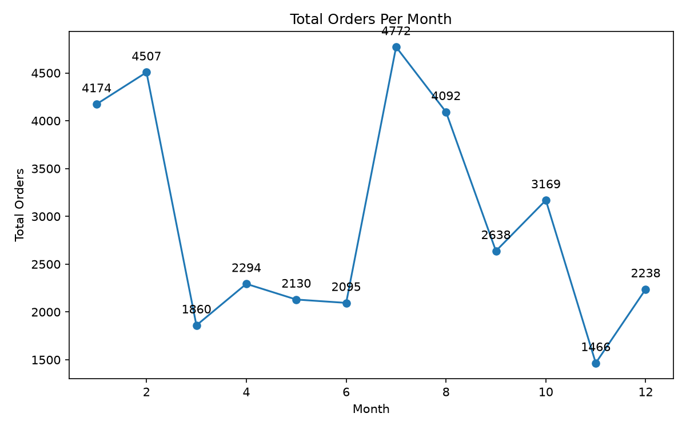
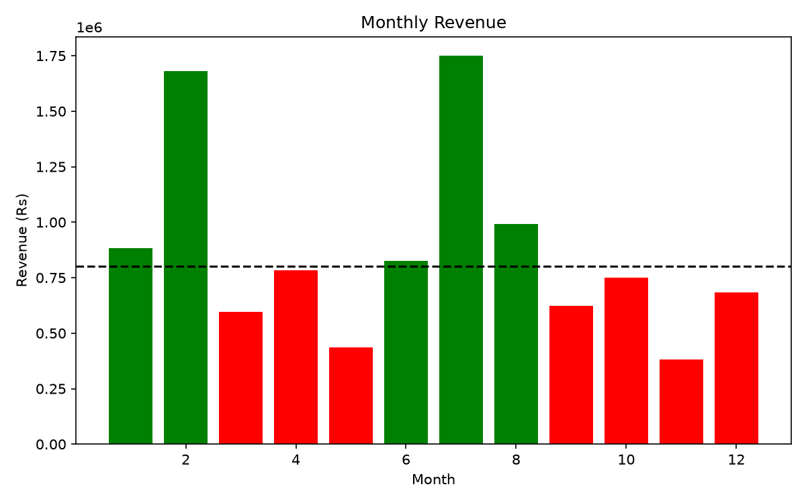
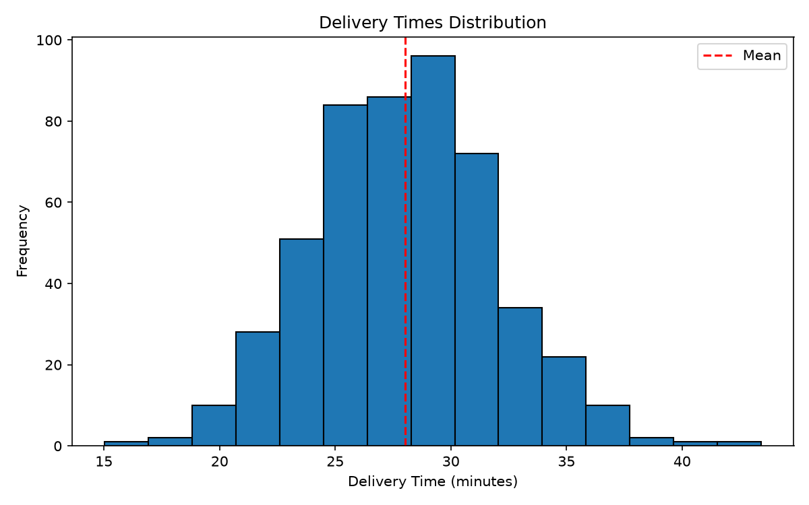
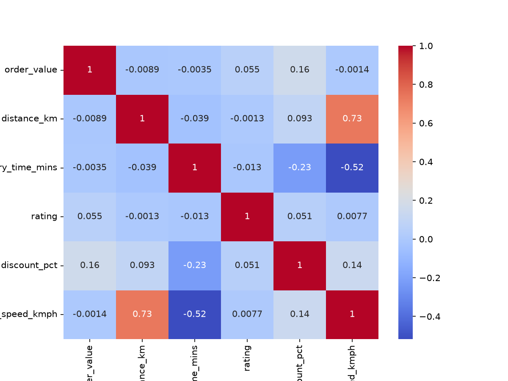
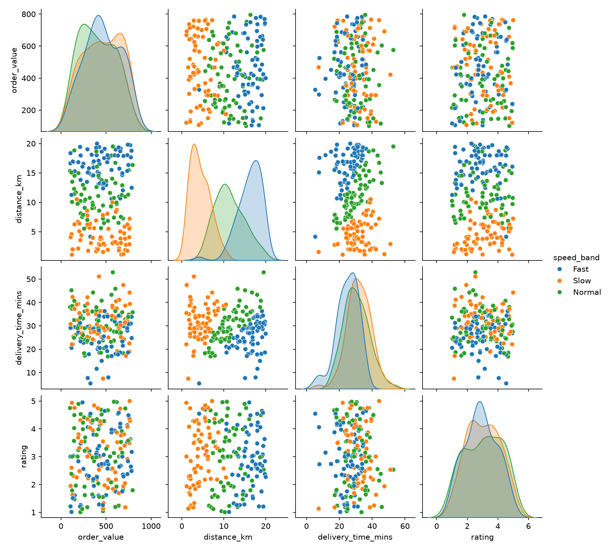

# Task 1: Delivery Fee Array Calculator (NumPy)
## Build a NumPy-based program that computes and analyses delivery fees for a batch of food orders using vectorised operations — no Python loops.
- Generate a 1D NumPy array of 25 random delivery distances between 1.0 km and 15.0 km using
np.random.uniform() with a fixed seed of 42.
- Compute the delivery fee for every order using the formula: fee = Rs 20 + Rs 5 × distance —
applied as a single vectorised expression, not a loop.
- Use boolean indexing to extract and print all orders where the delivery fee exceeds Rs 60,
showing both the distance and the fee for each qualifying order.
- Print the minimum, maximum, mean, and standard deviation of the complete fee array using
NumPy statistical functions.
### Code
```python
import numpy as np
np.random.seed(42)
distances=np.random.uniform(1.0,15.0,25)
fees=20+5*distances
delivery_fee=fees>60
print(np.column_stack((distances[delivery_fee],fees[delivery_fee])))
print(f"Minimum Fee: {fees.min():.2f}") 
print(f"Maximum Fee: {fees.max():.2f}")
print(f"Mean Fee: {fees.mean():.2f}")
print(f"Standard Deviation: {fees.std():.2f}")
```
### Output
```
[[14.31000029 91.55000145]
 [11.24791519 76.23957593]
 [ 9.38121878 66.90609389]
 [13.12646604 85.6323302 ]
 [ 9.41561016 67.07805082]
 [10.91301609 74.56508045]
 [14.57873793 92.89368965]
 [12.65419697 83.27098486]
 [ 8.34659004 61.73295021]
 [ 9.56594053 67.82970263]]
Minimum Fee: 26.44
Maximum Fee: 92.89
Mean Fee: 55.86
Standard Deviation: 19.56
```
<br>
<br>

# Task 2: Restaurant Performance Analyser (Pandas)
## Build a Pandas program that creates a food delivery dataset and produces a filtered, ranked summary of restaurant performance using groupby aggregation.
- Construct a DataFrame with at least 40 rows containing columns: restaurant_name (5 unique
names), city (3 unique cities), order_value, delivery_time_mins, rating (1.0–5.0), and
cuisine_type (3 types).
- Use groupby() and agg() in a single method chain to compute: mean order value, mean
delivery time, and mean rating — grouped by restaurant_name.
- Filter the grouped result to retain only restaurants with a mean rating above 4.0 and a mean
delivery time below 35 minutes.
- Sort the final output by mean order value in descending order, reset the index, and print the
complete result with column headers clearly visible.
### Code
```python
import numpy as np
import pandas as pd
np.random.seed(42)
df=pd.DataFrame({'restaurant_name':np.random.choice(['Das_Khaman',
                                                     'Agra_Sweet_Home',
                                                     'Honest','Toran_Dining',
                                                     'Mirch_Masala'],40),
                'city':np.random.choice(['Ahmedabad','Surat','Vadodara'],40),
                'order_value':np.random.uniform(100,500,40),
                'delivery_time_mins':np.random.uniform(15,38,40),
                'rating':np.random.uniform(3.5,5.0,40),
                'cuisine_type':np.random.choice(['Gujarati','Fast_Food','Punjabi'],40)})
result=df.groupby('restaurant_name').agg({'order_value':'mean','delivery_time_mins':'mean','rating':'mean'}).loc[lambda x:(x['rating']>4.0)&(x['delivery_time_mins']<35)].sort_values(by='order_value',ascending=False).reset_index()
print(result)
```
### Output
```
   restaurant_name  order_value  delivery_time_mins    rating
0           Honest   330.551420           24.616725  4.156961
1  Agra_Sweet_Home   302.984811           26.094107  4.211063
2     Toran_Dining   302.534382           28.764016  4.076050
3       Das_Khaman   295.449417           30.355780  4.111790
4     Mirch_Masala   218.258067           25.955836  4.160132
```
<br>
<br>

# Task 3: Monthly Order Trend Dashboard (Matplotlib)
## Build a Matplotlib figure with three subplots that together form a visual performance report for a food delivery platform across a 12-month period.
- Generate synthetic monthly data using NumPy: 12 months of total orders (random integers
1,000–5,000), monthly revenue (orders × random average order value between Rs 200–Rs
400), and average delivery time (normally distributed, mean=28, std=4).
- Subplot 1 — Line chart: Plot total orders per month with circular markers; annotate each data
point with its value displayed just above the marker.
- Subplot 2 — Bar chart: Plot monthly revenue; colour each bar green if revenue exceeds Rs
8,00,000 and red otherwise, and draw a horizontal dashed line at the Rs 8,00,000 threshold.
- Subplot 3 — Histogram: Plot 500 simulated delivery times (use the generated mean and std)
with 15 bins; add a vertical dashed line at the sample mean labelled 'Mean'.
- Apply a figure title, individual subplot titles, axis labels on all subplots, and plt.tight_layout(); save the figure as food_delivery_dashboard.png at DPI 150.
### Subplot 1
```python
import numpy as np
import matplotlib.pyplot as plt
np.random.seed(42)
month=np.arange(1,13)
orders=np.random.randint(1000,5001,size=12)
plt.figure(figsize=(8,5))
plt.plot(month,orders,marker='o')
for i,t in enumerate(orders):plt.annotate(str(t),(month[i],orders[i]),textcoords="offset points",xytext=(0,10),ha='center')
plt.title('Total Orders Per Month')
plt.xlabel('Month')
plt.ylabel('Total Orders')
plt.tight_layout()
plt.savefig('orders.png',dpi=150)
plt.show()
```
### Output

<br>

### Subplot 2
```python
import numpy as np
import matplotlib.pyplot as plt
np.random.seed(42)
month=np.arange(1,13)
orders=np.random.randint(1000,5001,size=12)
revenue=orders*np.random.uniform(200,400,size=12)
color=['green'if x>800000 else'red'for x in revenue]
plt.figure(figsize=(8,5))
plt.bar(month,revenue,color=color)
plt.axhline(800000,color='black',linestyle='--')
plt.title('Monthly Revenue')
plt.xlabel('Month')
plt.ylabel('Revenue (Rs)')
plt.tight_layout()
plt.savefig('revenue.png',dpi=150)
plt.show()
```
### Output

<br>

### Subplot 3
```python
import numpy as np
import matplotlib.pyplot as plt
np.random.seed(42)
delivery_time=np.random.normal(loc=28,scale=4,size=500)
mean=np.mean(delivery_time)
plt.figure(figsize=(8,5))
plt.hist(delivery_time,bins=15,edgecolor='black')
plt.axvline(mean,color='red',linestyle='--',label='Mean')
plt.title('Delivery Times Distribution')
plt.xlabel('Delivery Time (minutes)')
plt.ylabel('Frequency')
plt.legend()
plt.tight_layout()
plt.savefig('delivery_times.png',dpi=150)
plt.show()
```
### Output

<br>

# Task 4: Full EDA Pipeline — Food Delivery Insights (NumPy)
## Build an end-to-end exploratory analysis pipeline that generates, cleans, enriches, and visualises a synthetic food delivery dataset using all four modules in sequence.
- Use NumPy (seed=7) to generate a 200-row dataset with columns: order_value (uniform Rs
100–Rs 800), distance_km (uniform 1–20), delivery_time_mins (normal ?=30, ?=8), rating
(uniform 1.0–5.0), and discount_pct (uniform 0–30); load it into a Pandas DataFrame.
- Artificially introduce 5% null values into the delivery_time_mins and rating columns using
np.random.choice(); then fill all nulls with the respective column medians.
- Add a derived column: delivery_speed_kmph = distance_km / (delivery_time_mins / 60);
classify each row into a speed_band category ('Fast', 'Normal', 'Slow') using pd.qcut() on
delivery_speed_kmph with 3 equal-frequency bins.
- Produce a Seaborn heatmap of the Pearson correlation matrix for all numeric columns with
annotated values (annot=True) and a diverging colour palette; save as
correlation_heatmap.png.
- Produce a Seaborn pairplot of order_value, distance_km, delivery_time_mins, and rating,
coloured by speed_band; save as pairplot.png. Both charts must be saved at DPI >= 150 using
plt.savefig().
### Task 1- Data generation
```python
import numpy as np
import pandas as pd
np.random.seed(7)
df=pd.DataFrame({'order_value':np.random.uniform(100,800,200),
                 'distance_km':np.random.uniform(1,20,200),
                 'delivery_time_mins':np.random.normal(30,8,200),
                 'rating':np.random.uniform(1.0,5.0,200),
                 'discount_pct':np.random.uniform(0,30,200)})
df.to_csv('orders.csv',index=False)
print(df.head())
```
### Output
```
   order_value  distance_km  delivery_time_mins    rating  discount_pct
0   153.415803    15.287118           29.436359  1.610398     17.079069
1   645.943155     2.171641           41.143419  1.247733      4.256927
2   406.886462    15.151650           20.002291  3.285994     18.347489
3   606.425624    18.979243           18.019293  1.749068     29.233717
4   784.592658    12.467631           24.767687  3.171931      8.202608
```
<br>

### Task 2- Data cleaning
```python
import numpy as np
import pandas as pd
df=pd.read_csv('orders.csv')
for col in['delivery_time_mins','rating']:
    idx=np.random.choice(df.index,size=int(0.05*len(df)),replace=False)
    df.loc[idx,col]=np.nan
    df[col]=df[col].fillna(df[col].median())
df.to_csv('orders.csv',index=False)
print(df.isnull().sum())
print(df.head())
```
### Output
```
order_value           0
distance_km           0
delivery_time_mins    0
rating                0
discount_pct          0
dtype: int64
   order_value  distance_km  delivery_time_mins    rating  discount_pct
0   153.415803    15.287118           29.436359  1.610398     17.079069
1   645.943155     2.171641           41.143419  1.247733      4.256927
2   406.886462    15.151650           20.002291  3.285994     18.347489
3   606.425624    18.979243           18.019293  1.749068     29.233717
4   784.592658    12.467631           24.767687  3.171931      8.202608
```
<br>

### Task 3- Data addition
```python
import pandas as pd
df=pd.read_csv('orders.csv')
df['delivery_speed_kmph']=df['distance_km']/(df['delivery_time_mins']/60)
df['speed_band']=pd.qcut(df['delivery_speed_kmph'],3,labels=['Slow','Normal','Fast'])
df.to_csv('orders.csv',index=False)
print(df[['delivery_speed_kmph','speed_band']].head())
```
### Output
```
   delivery_speed_kmph speed_band
0            31.159664       Fast
1             3.166934       Slow
2            45.449742       Fast
3            63.196404       Fast
4            30.202978       Fast
```
<br>

### Task 4- Heatmap correlation
```python
import matplotlib.pyplot as plt
import seaborn as sns
import numpy as np
import pandas as pd
df=pd.read_csv('orders.csv')
plt.figure(figsize=(8,6))
sns.heatmap(df.select_dtypes(include=[np.number]).corr(),annot=True,cmap='coolwarm')
plt.savefig('correlation_heatmap.png',dpi=150)
plt.show()
print(df.select_dtypes(include=[np.number]).corr())
```
### Output

```
                     order_value  distance_km  ...  discount_pct  delivery_speed_kmph
order_value             1.000000    -0.008902  ...      0.159267            -0.001353
distance_km            -0.008902     1.000000  ...      0.093225             0.734567
delivery_time_mins     -0.003464    -0.038869  ...     -0.225420            -0.517353
rating                  0.055108    -0.001258  ...      0.050716             0.007718
discount_pct            0.159267     0.093225  ...      1.000000             0.139205
delivery_speed_kmph    -0.001353     0.734567  ...      0.139205             1.000000

[6 rows x 6 columns]
```
<br>

### Task 5- Pairplot
```python
import matplotlib.pyplot as plt
import seaborn as sns
import pandas as pd
df=pd.read_csv('orders.csv')
sns.pairplot(df,vars=['order_value','distance_km','delivery_time_mins','rating'],hue='speed_band')
plt.savefig('pairplot.png',dpi=150)
plt.show()
print(df['speed_band'].value_counts())
```
### Output

```
speed_band
Fast      67
Slow      67
Normal    66
Name: count, dtype: int64
```