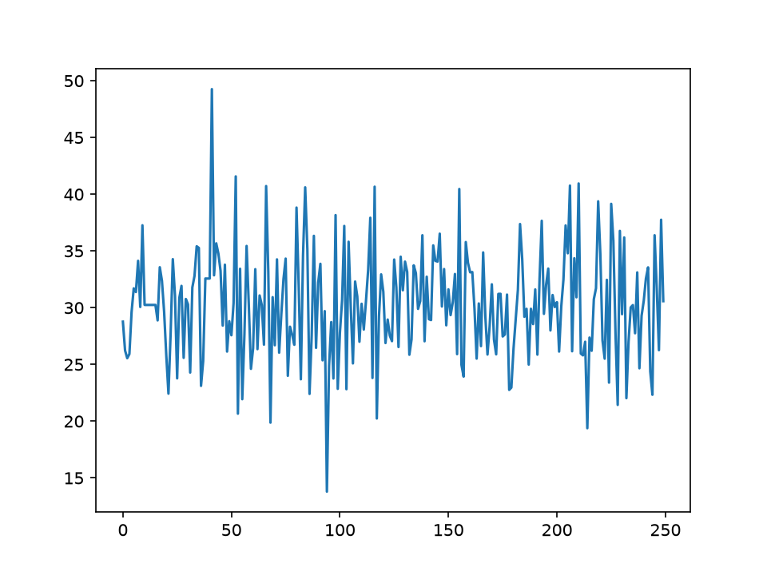
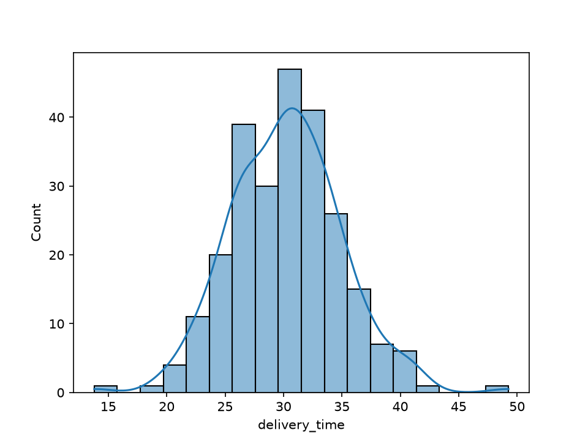
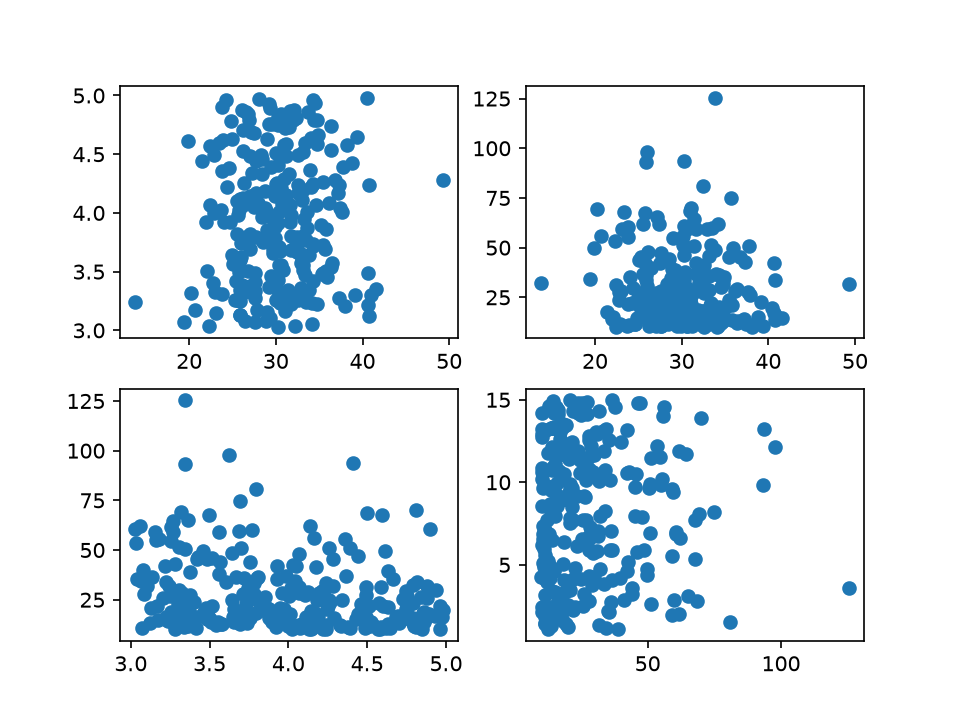
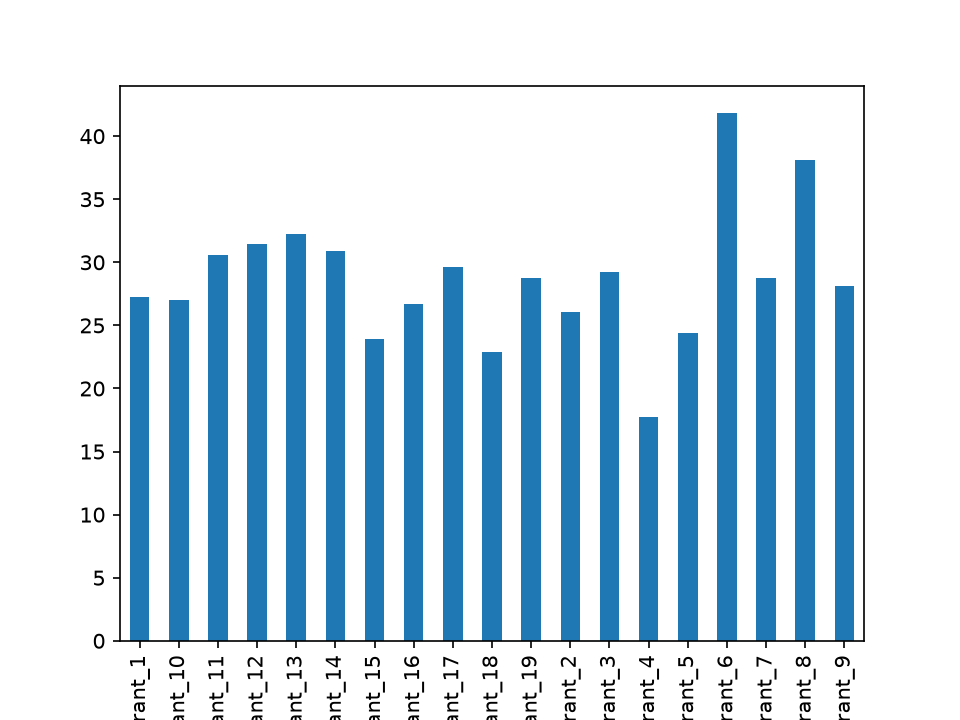

# Mini Project:  Food Delivery Analytics Console — Full EDA Report
## Objective: Build a menu-driven Python console program that performs a complete exploratory data analysis on a synthetic food delivery dataset, integrating NumPy array operations, Pandas data wrangling, Matplotlib charting, and Seaborn statistical visualisation into a single cohesive script.
## Your project must:
- The program must present a numbered menu with at least 4 analysis options: (1) Summary
Statistics, (2) Distribution Analysis, (3) Correlation Heatmap, (4) Restaurant Performance
Report — and loop until the user chooses to exit.
- Each menu option must be implemented as a separate function; each function must use at
least one technique from a different module (NumPy statistical functions, Pandas groupby,
Matplotlib subplot, or Seaborn plot) — no function may duplicate another's primary technique.
- The underlying dataset must have at least 200 rows, generated with NumPy at program
startup; the program must check for and fill any null values in numeric columns before any
analysis option is invoked.
- All charts produced by the menu options must be saved as PNG files with descriptive
filenames and DPI >= 150 — charts must not be displayed interactively during menu operation.
- After the user exits the menu, the program must print a plain-text summary report to the
console listing: the top 3 restaurants by mean rating, the numeric column pair with the highest
absolute Pearson correlation, and the overall mean and standard deviation of delivery time
across the full dataset.
### Code
```python
import numpy as np
import pandas as pd
import matplotlib.pyplot as plt
import seaborn as sns
np.random.seed(42)
num_rows=250
restaurants=[f"Restaurant_{i}" for i in np.random.randint(1,20,num_rows)]
delivery_time=np.random.normal(30,5,num_rows)
rating=np.random.uniform(3.0,5.0,num_rows)
order_value=np.random.exponential(20,num_rows)+10
distance=np.random.uniform(1,15,num_rows)
df=pd.DataFrame({'restaurant':restaurants,'delivery_time':delivery_time,'rating':rating,'order_value':order_value,'distance':distance})
df.loc[10:15,'delivery_time']=np.nan
df.fillna(df.mean(numeric_only=True),inplace=True)
def summary_statistics(data):
 delivery_values=data['delivery_time'].values
 print("Mean:",np.mean(delivery_values))
 print("Std:",np.std(delivery_values))
 print("Median:",np.median(delivery_values))
 fig,axis=plt.subplots()
 axis.plot(delivery_values)
 plt.savefig("summary.png",dpi=150)
 plt.show()
def distribution_analysis(data):
 sns.histplot(data['delivery_time'],kde=True)
 plt.savefig("distribution.png",dpi=150)
 plt.show()
def correlation_heatmap(data):
 fig,axes=plt.subplots(2,2)
 numeric_data=data.select_dtypes(include=[np.number])
 axes[0,0].scatter(numeric_data.iloc[:,0],numeric_data.iloc[:,1])
 axes[0,1].scatter(numeric_data.iloc[:,0],numeric_data.iloc[:,2])
 axes[1,0].scatter(numeric_data.iloc[:,1],numeric_data.iloc[:,2])
 axes[1,1].scatter(numeric_data.iloc[:,2],numeric_data.iloc[:,3])
 plt.savefig("correlation.png",dpi=150)
 plt.show()
def restaurant_performance(data):
 grouped_performance=data.groupby('restaurant')['order_value'].mean()
 grouped_performance.plot(kind='bar')
 plt.savefig("restaurant_performance.png",dpi=150)
 plt.show()
while True:
 choice=input("1: Summary Statistics\n2: Distribution Analysis\n3: Correlation Heatmap\n4: Restaurant Performance Report\n5: Exit\nSelect option: ")
 if choice=='1':summary_statistics(df)
 elif choice=='2':distribution_analysis(df)
 elif choice=='3':correlation_heatmap(df)
 elif choice=='4':restaurant_performance(df)
 elif choice=='5':break
top_restaurants=df.groupby('restaurant')['rating'].mean().nlargest(3)
print("Top 3 Restaurants by Mean Rating:")
print(top_restaurants)
numeric_dataframe=df.select_dtypes(include=[np.number])
correlation_matrix=numeric_dataframe.corr().abs()
unstacked_corr=correlation_matrix.unstack()
unstacked_corr=unstacked_corr[unstacked_corr<1.0]
highest_pair=unstacked_corr.idxmax()
print("Highest Absolute Pearson Correlation Pair:",highest_pair)
print("Overall Mean Delivery Time:",np.mean(df['delivery_time']))
print("Overall Std Delivery Time:",np.std(df['delivery_time']))
```
### Output

```
1: Summary Statistics
2: Distribution Analysis
3: Correlation Heatmap
4: Restaurant Performance Report
5: Exit
Select option: 1
Mean: 30.24573621917609
Std: 4.714155841450425
Median: 30.245736219176088
```
```
1: Summary Statistics
2: Distribution Analysis
3: Correlation Heatmap
4: Restaurant Performance Report
5: Exit
Select option: 2
```

```
1: Summary Statistics
2: Distribution Analysis
3: Correlation Heatmap
4: Restaurant Performance Report
5: Exit
Select option: 3
```

```
1: Summary Statistics
2: Distribution Analysis
3: Correlation Heatmap
4: Restaurant Performance Report
5: Exit
Select option: 4
```

```
1: Summary Statistics
2: Distribution Analysis
3: Correlation Heatmap
4: Restaurant Performance Report
5: Exit
Select option: 5
Top 3 Restaurants by Mean Rating:
restaurant
Restaurant_16    4.291039
Restaurant_3     4.093782
Restaurant_5     4.069998
Name: rating, dtype: float64
Highest Absolute Pearson Correlation Pair: ('rating', 'order_value')
Overall Mean Delivery Time: 30.24573621917609
Overall Std Delivery Time: 4.714155841450425
```