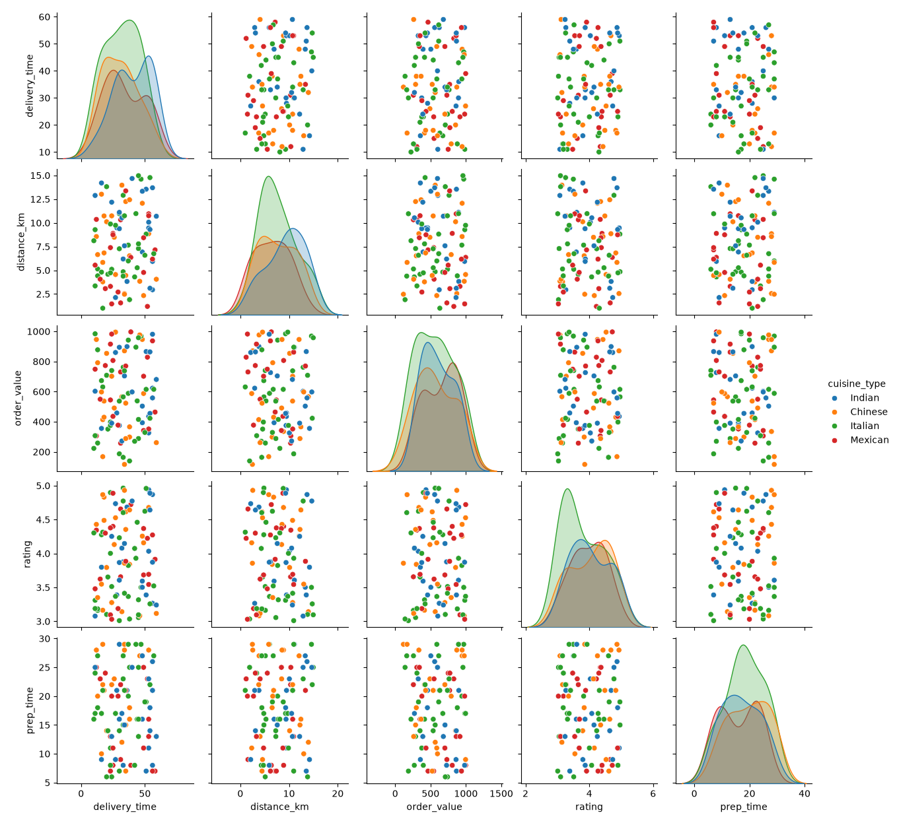
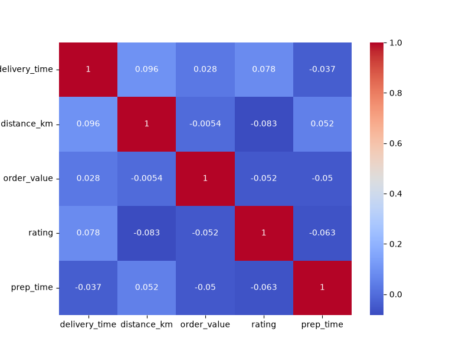
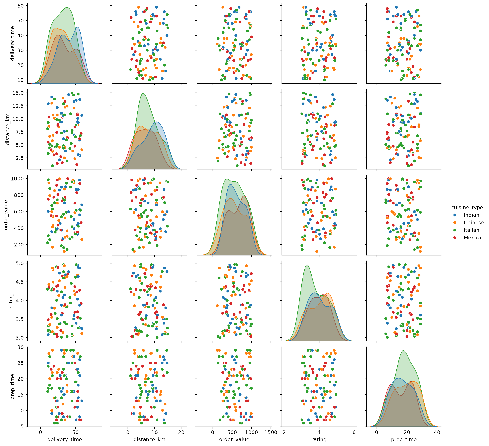
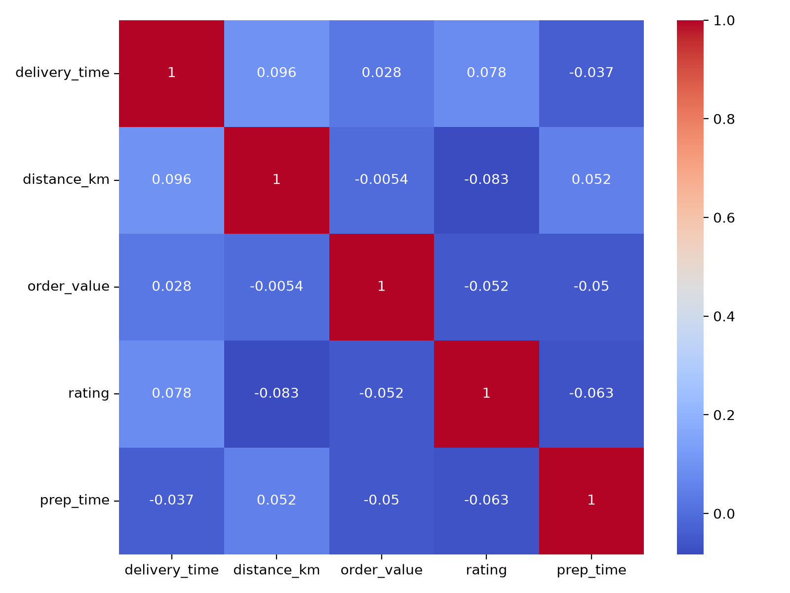

# STEP 1- BUILD WITH AI
## Use an AI tool of your choice (ChatGPT, Claude, GitHub Copilot, etc.) to help you write a Python program that: 
- Generates a synthetic food delivery dataset with at least 5 numeric columns and one categorical column (e.g., cuisine_type) using NumPy, loaded into a Pandas DataFrame.
- Produces a Seaborn pairplot of all numeric columns, coloured by the categorical column, and
saves it as a PNG file.
- Computes the Pearson correlation matrix and displays it as a Seaborn heatmap with
annotated cell values and a diverging colour palette.
- Exports the heatmap as a separate PNG file at DPI 200 with a descriptive filename.
# STEP 2- TEST & DEBUG  (WITHOUT AI):
## Then, working without AI, run the code on your machine and identify at least one bug, limitation or improvement in the AI's solution — for example: missing DPI on savefig(), incorrect DataFrame dtypes, or a pairplot that breaks when the categorical column has null values. Fix the issue yourself.
### Prompt given to AI: Write a Python program that generates a synthetic food delivery dataset with at least 5 numeric columns and one categorical column (cuisine_type) using NumPy, loaded into a Pandas DataFrame. Produce a Seaborn pairplot of all numeric columns, coloured by cuisine_type, and save it as orders.png. Compute the Pearson correlation matrix and display it as a Seaborn heatmap with annotated cell values and a diverging colour palette. Export the heatmap as a separate PNG file at DPI 200 with a descriptive filename correlation_heatmap.png.
### AI's OG Code:
```python
import numpy as np
import pandas as pd
import seaborn as sns
import matplotlib.pyplot as plt

# Set random seed for reproducibility
np.random.seed(42)
n = 100

# Generate synthetic food delivery dataset using NumPy
data = {
    'delivery_time': np.random.randint(10, 60, n),
    'distance_km': np.random.uniform(1, 15, n),
    'order_value': np.random.uniform(100, 1000, n),
    'rating': np.random.uniform(3.0, 5.0, n),
    'prep_time': np.random.randint(5, 30, n),
    'cuisine_type': np.random.choice(['Italian', 'Chinese', 'Indian', 'Mexican'], n)
}

# Load the generated data into a Pandas DataFrame
df = pd.DataFrame(data)

# Produce a Seaborn pairplot of all numeric columns, coloured by cuisine_type, and save as orders.png
sns.pairplot(df, hue='cuisine_type')
plt.savefig('orders.png')
plt.close()

# Compute the Pearson correlation matrix for numeric columns
plt.figure(figsize=(8, 6))
corr = df.select_dtypes(include=[np.number]).corr()

# Display the correlation matrix as a Seaborn heatmap and save as correlation_heatmap.png
sns.heatmap(corr, annot=True, cmap='coolwarm')
plt.savefig('correlation_heatmap.png')
plt.close()
```
### Output


<br>
<br>

### Corrected Code:
```python
import numpy as np
import pandas as pd
import seaborn as sns
import matplotlib.pyplot as plt
np.random.seed(42)
num_orders=100
delivery_data={'delivery_time':np.random.randint(10,60,num_orders),'distance_km':np.random.uniform(1,15,num_orders),'order_value':np.random.uniform(100,1000,num_orders),'rating':np.random.uniform(3.0,5.0,num_orders),'prep_time':np.random.randint(5,30,num_orders),'cuisine_type':np.random.choice(['Italian','Chinese','Indian','Mexican'],num_orders)}
delivery_df=pd.DataFrame(delivery_data)
pairplot_grid=sns.pairplot(delivery_df,hue='cuisine_type')
pairplot_grid.savefig('food_orders.png',dpi=200)
plt.show()
plt.figure(figsize=(8,6))
correlation_matrix=delivery_df.select_dtypes(include=[np.number]).corr()
sns.heatmap(correlation_matrix,annot=True,cmap='coolwarm')
plt.tight_layout()
plt.savefig('food_correlation_heatmap.png',dpi=200)
plt.show()
```
### Output


The AI's original code used standard plt.savefig() which fails to correctly capture Seaborn's PairGrid object and omitted the required DPI setting for the pairplot. I fixed this by assigning the pairplot to a variable and calling its native .savefig() method with dpi=200, while also adding plt.tight_layout() to the heatmap to prevent label clipping.