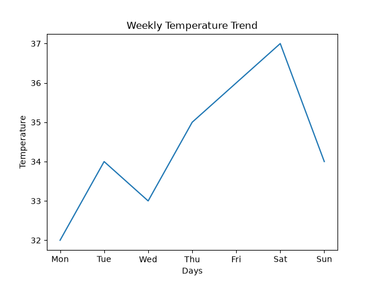
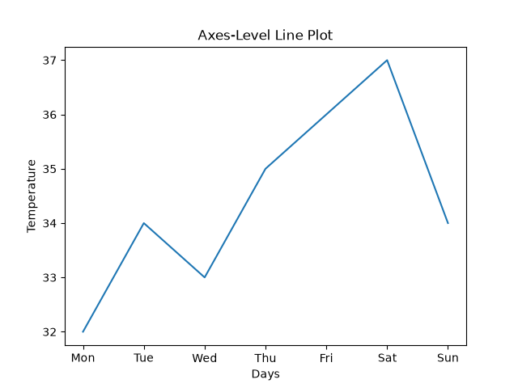
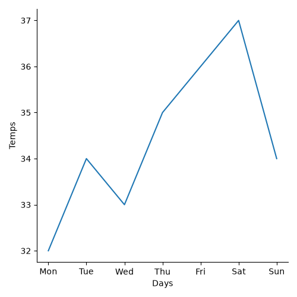
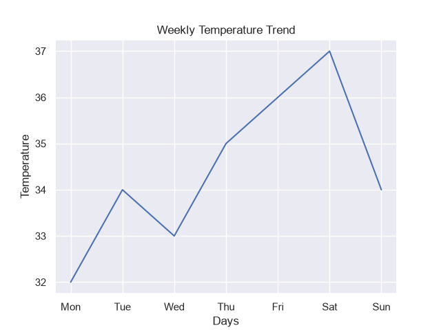
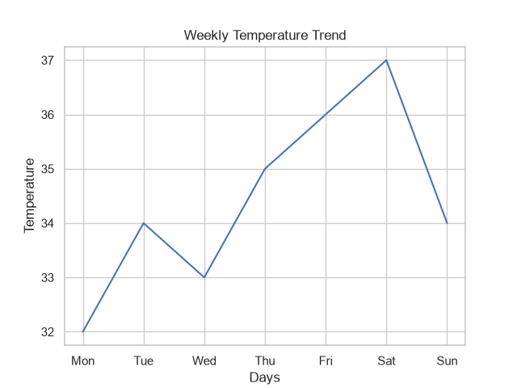
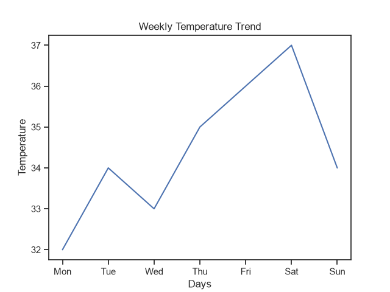

# Task 1
## Install Seaborn in your Python environment and create a new Jupyter notebook named seaborn_intro.ipynb. Import seaborn as sns and matplotlib.pyplot as plt, then display the versions of both libraries.
### Code
```python
import seaborn as sns
import matplotlib.pyplot as plt
print(sns.__version__)
print(plt.matplotlib.__version__)
```
### Output
```
0.13.2
3.11.2
```
<br>
<br>

# Task 2Using Seaborn's lineplot(), plot the daily temperature trend for one week using the following data: days = ['Mon', 'Tue', 'Wed', 'Thu', 'Fri', 'Sat', 'Sun'], temps = [32, 34, 33, 35, 36, 37, 34]. Label the axes and title the chart 'Weekly Temperature Trend'.
### Code
```python
import seaborn as sns
import matplotlib.pyplot as plt
days=['Mon','Tue','Wed','Thu','Fri','Sat','Sun']
temps=[32,34,33,35,36,37,34]
sns.lineplot(x=days,y=temps)
plt.xlabel('Days')
plt.ylabel('Temperature')
plt.title('Weekly Temperature Trend')
plt.savefig('weekly_temperature_trend.png')
plt.show()
```
### Output

<br>

# Task 3
## Recreate the above line plot using Seaborn's axes-level and figure-level functions separately. Briefly note one difference you observe in how these functions work.<br><br><em><strong>Hint:</strong> Use sns.lineplot() for axes-level and sns.relplot() for figure-level.</em>
### Code
```python
import seaborn as sns
import matplotlib.pyplot as plt
import pandas as pd
df=pd.DataFrame({'Days':['Mon','Tue','Wed','Thu','Fri','Sat','Sun'],
                 'Temps':[32,34,33,35,36,37,34]})
plt.figure()
sns.lineplot(data=df,x='Days',y='Temps')
plt.xlabel('Days')
plt.ylabel('Temperature')
plt.title('Axes-Level Line Plot')
plt.savefig('axes_level.png')
plt.show()
sns.relplot(data=df,x='Days',y='Temps',kind='line')
plt.savefig('figure_level.png')
plt.show()
```
### Output


Axes-Level: Plots data onto a specific Matplotlib Axes object and returns that axes, allowing direct integration into existing Matplotlib figure layouts and subplots.

Figure-Level: Manages the entire figure via a Grid, wrapping multiple axes and facilitating multi-plot panel grids, but it controls its own figure dimensions and layout structure.
<br>

# Task 4
## Apply each of Seaborn's built-in themes (darkgrid, whitegrid, ticks) to your temperature trend plot and save three separate images. Compare how the grid and background change with each theme.<br><br><em><strong>Hint:</strong> Use sns.set_theme(style='theme_name') before plotting.</em>
### Code
```python
import seaborn as sns
import matplotlib.pyplot as plt
days=['Mon','Tue','Wed','Thu','Fri','Sat','Sun']
temps=[32,34,33,35,36,37,34]
for t in ['darkgrid','whitegrid','ticks']:
    sns.set_theme(style=t)
    plt.figure()
    sns.lineplot(x=days,y=temps)
    plt.xlabel('Days')
    plt.ylabel('Temperature')
    plt.title('Weekly Temperature Trend')
    plt.savefig(f'{t}.png')
    plt.show()
```
### Output



darkgrid: displays a grey background with a white grid, offering strong contrast that makes data lines stand out clearly.

whitegrid: features a clean white background paired with subtle grey grid lines, delivering a modern aesthetic while maintaining precise value tracking.

ticks: presents a minimalist white background without any grid lines, featuring small outward-facing tick marks on the axis borders for a classic appearance.
