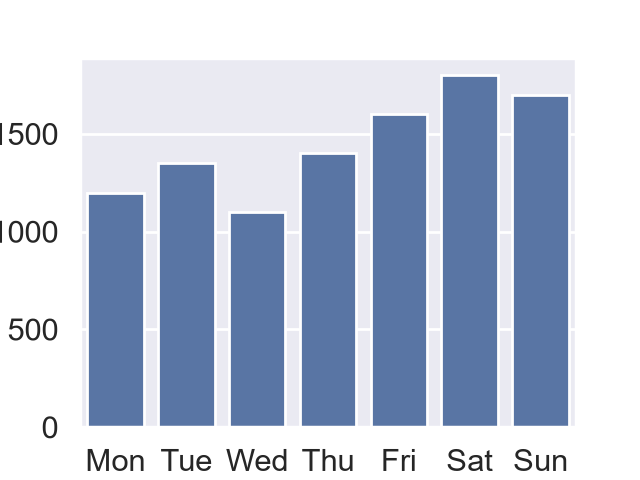
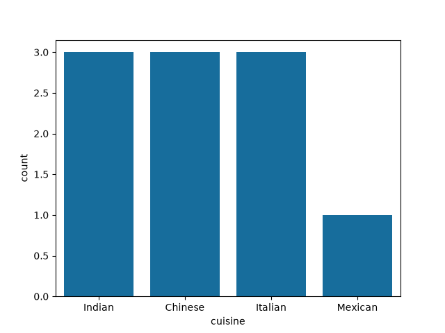
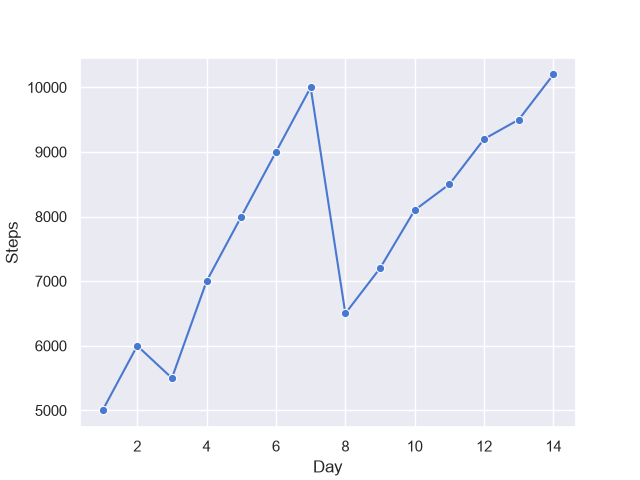
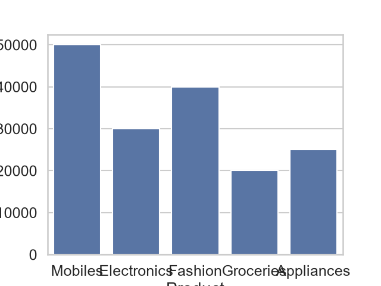

# Task 1
## Use sns.set() to apply the 'poster' context to a Seaborn barplot showing the number of songs streamed per day on Spotify, and observe how the plot elements change compared to the default context.
### Code
```python
import matplotlib.pyplot as plt
import seaborn as sns
import pandas as pd
sns.set(context='poster')
df=pd.DataFrame({'Day':['Mon','Tue','Wed','Thu','Fri','Sat','Sun'],
                 'Streams':[1200,1350,1100,1400,1600,1800,1700]})
sns.barplot(x='Day',y='Streams',data=df)
plt.savefig('song_stream.png')
plt.show()
```
### Output

<br>


# Task 2
## Create a Seaborn countplot showing the distribution of food orders by cuisine type (e.g., Indian, Chinese, Italian) using a 'colorblind' palette, similar to how Zomato might visualize order trends.<br><br><em><strong>Hint:</strong> Use palette='colorblind' in your plot function.</em>
### Code
```python
import matplotlib.pyplot as plt
import seaborn as sns
import pandas as pd
df=pd.DataFrame({'cuisine':['Indian','Chinese','Italian',
                            'Indian','Italian','Chinese','Indian',
                            'Chinese','Italian','Mexican']})
sns.set_palette('colorblind')
sns.countplot(data=df,x='cuisine')
plt.savefig('cuisine.png')
plt.show()
```
### Output

<br>

# Task 3
## Generate a Seaborn lineplot of daily step counts (simulate data for 2 weeks) and style it using the 'muted' palette and 'notebook' context for a clean, presentation-ready look.
### Code
```python
import matplotlib.pyplot as plt
import seaborn as sns
import pandas as pd
sns.set(context='notebook',palette='muted')
df=pd.DataFrame({'Day':range(1,15),'Steps':[5000,6000,5500,7000,8000,9000,
                                            10000,6500,7200,8100,8500,9200,
                                            9500,10200]})
sns.lineplot(data=df,x='Day',y='Steps',marker='o')
plt.savefig('daily_steps.png')
plt.show()
```
### Output

<br>

# Task 4
## Refactor an existing Seaborn plot by switching its palette from 'deep' to 'colorblind' and changing the context from 'talk' to 'poster'. Briefly describe the visual differences you notice after applying these changes.
### Code
```python
import matplotlib.pyplot as plt
import seaborn as sns
import pandas as pd
sns.set(context='poster',palette='colorblind')
df=pd.DataFrame({'Day':range(1,15),'Steps':[5000,6000,5500,7000,8000,9000,
                                            10000,6500,7200,8100,8500,9200,
                                            9500,10200]})
sns.barplot(data=df,x='Day',y='Steps')
plt.savefig('daily_steps_colorblind.png')
plt.show()
```
### Output

Switching from the context to 'poster' significantly increases font sizes, line widths, and marker sizes to optimize readability for large display formats. Changing the palette from 'deep' to 'colorblind' alters the color scheme to ensure distinction for individuals with color vision deficiencies.
<br>

# Task 5
## Design a Seaborn theme that mimics the look of a Flipkart sales dashboard: use sns.set() to set a 'deep' palette, 'talk' context, and customize the font scale and grid style. Apply your theme to a barplot showing sales of 5 product categories.
### Code
```python
import matplotlib.pyplot as plt
import seaborn as sns
import pandas as pd
sns.set(context='talk',palette='deep',font_scale=1.1,style='whitegrid')
df=pd.DataFrame({'Product':['Mobiles','Electronics','Fashion','Groceries','Appliances'],
                 'Sales':[50000,30000,40000,20000,25000]})
sns.barplot(data=df,x='Product',y='Sales')
plt.savefig('flipkart_sales.png')
plt.show()
```
### Output

\s