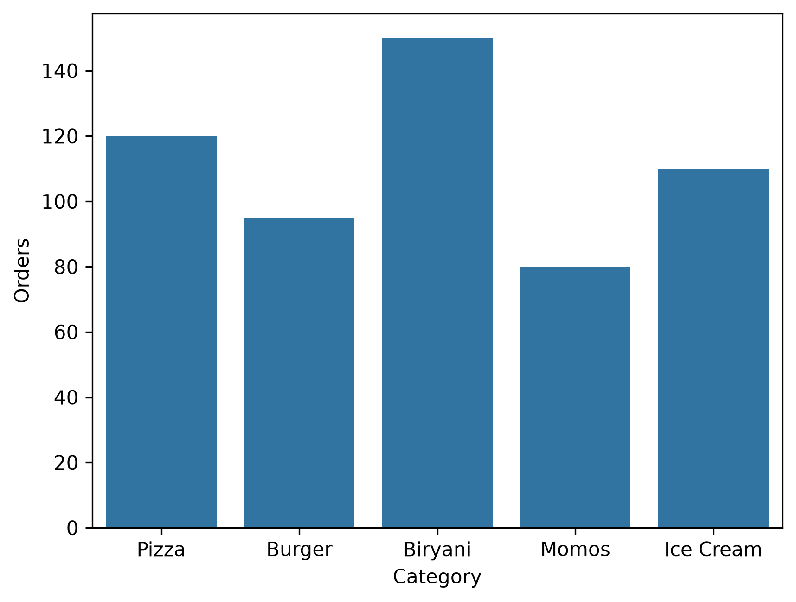
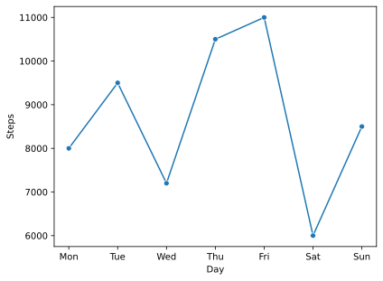
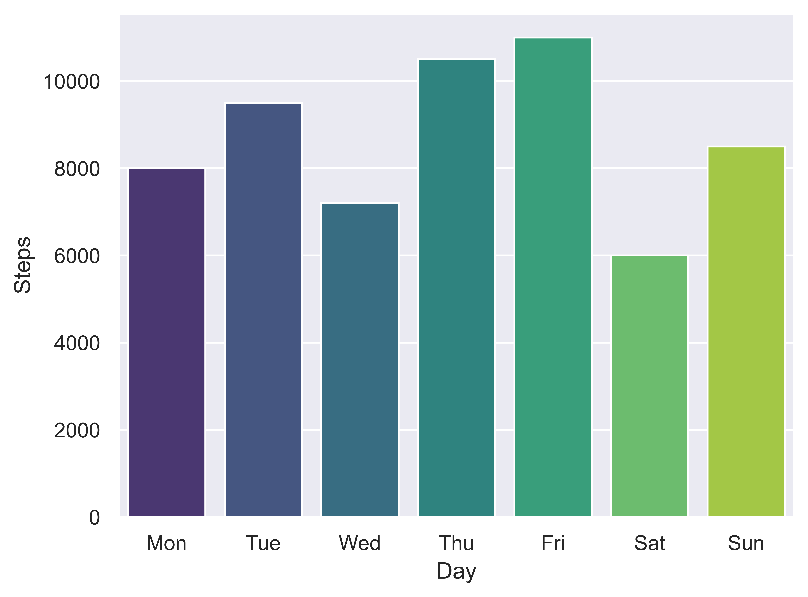
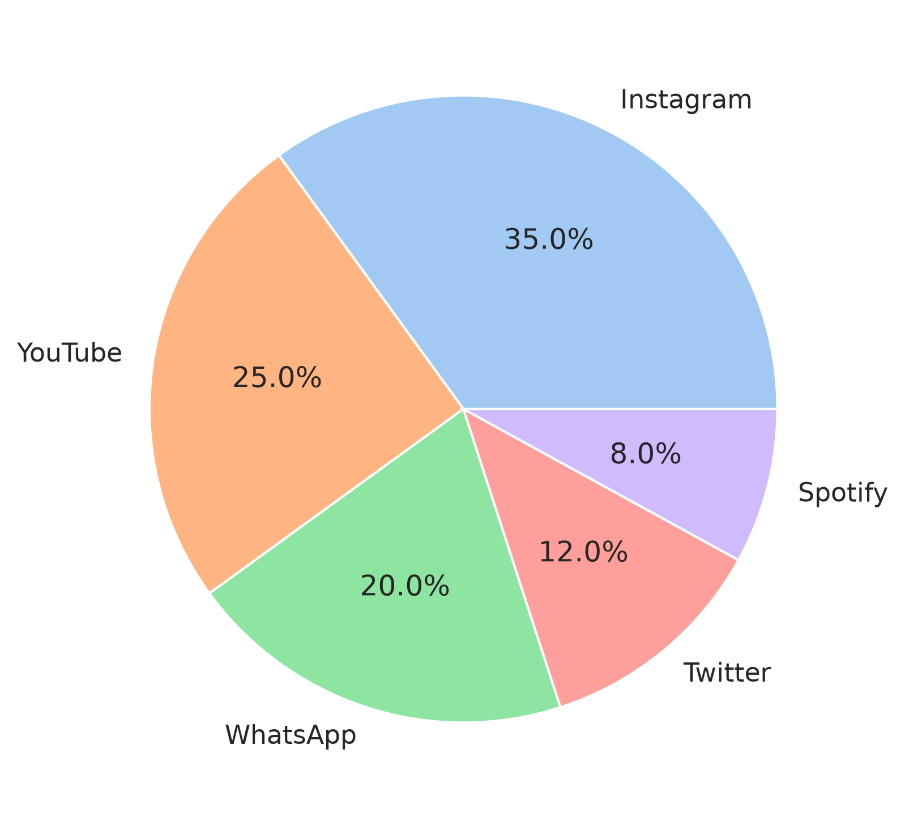
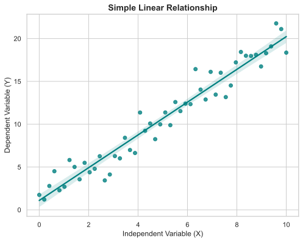

# Task 1
## Create a Seaborn barplot showing the number of orders per food category (e.g., Pizza, Burger, Biryani, Momos, Ice Cream) and save the chart as a PNG file with 300 DPI.
### Code
```python
import pandas as pd
import seaborn as sns
import matplotlib.pyplot as plt
df=pd.DataFrame({'Category':['Pizza','Burger','Biryani','Momos','Ice Cream'],
                 'Orders':[120,95,150,80,110]})
sns.barplot(data=df,x='Category',y='Orders')
plt.savefig('food.png',dpi=300,bbox_inches='tight')
plt.show()
```
### Output

<br>

# Task 2
## Generate a Seaborn line plot visualizing daily step counts for one week, then export the chart as an SVG file suitable for use in a PowerPoint presentation.<br><br><em><strong>Hint:</strong> Use plt.savefig('filename.svg', format='svg').</em>
### Code
```python
import pandas as pd
import seaborn as sns
import matplotlib.pyplot as plt
df=pd.DataFrame({'Day':['Mon','Tue','Wed','Thu','Fri','Sat','Sun'],
                 'Steps':[8000,9500,7200,10500,11000,6000,8500]})
sns.lineplot(data=df,x='Day',y='Steps',marker='o')
plt.savefig('steps_daily.svg',format='svg',bbox_inches='tight')
plt.show()
```
### Output

<br>

# Task 3
## Customize a Seaborn chart using the 'darkgrid' style and a color palette of your choice, then save it as a high-resolution PNG image with 1200 DPI.
### Code
```python
import pandas as pd
import seaborn as sns
import matplotlib.pyplot as plt
sns.set_theme(style='darkgrid')
df=pd.DataFrame({'Day':['Mon','Tue','Wed','Thu','Fri','Sat','Sun'],
                 'Steps':[8000,9500,7200,10500,11000,6000,8500]})
sns.barplot(data=df,x='Day',y='Steps',palette='viridis')
plt.savefig('steps_daily_dark.png',dpi=1200,bbox_inches='tight')
plt.show()
```
### Output

<br>

# Task 4
## Create a template function called apply_presentation_theme() that applies a consistent Seaborn style, font, and color palette to any chart, then use it to style and export a pie chart showing your top 5 most-used apps.
### Code
```python
import seaborn as sns
import matplotlib.pyplot as plt
def apply_presentation_theme():
    sns.set_theme(style='whitegrid',palette='pastel')
    plt.rcParams['font.sans-serif']='DejaVu Sans'
apps=['Instagram','YouTube','WhatsApp','Twitter','Spotify']
usage=[35,25,20,12,8]
apply_presentation_theme()
plt.figure(figsize=(6,6))
plt.pie(usage,labels=apps,autopct='%1.1f%%')
plt.savefig('top_apps.png',dpi=300,bbox_inches='tight')
plt.show()
```
### Output

<br>

# Task 5
## Use ChatGPT to generate a code snippet for exporting a Seaborn heatmap as a 1200 DPI SVG file, then test and adapt the code to save your own chart.<br><br><em><strong>Hint:</strong> Paste your prompt and the code you received as a comment in your script.</em>
### Code
```python
import seaborn as sns
import matplotlib.pyplot as plt
import numpy as np
sns.set_theme(style="whitegrid")
np.random.seed(42)
x=np.linspace(0,10,50)
y=2*x+1+np.random.normal(0,1.5,50)
plt.figure(figsize=(8,6))
sns.regplot(x=x,y=y,color="teal",scatter_kws={'alpha':0.8})
plt.title("Simple Linear Relationship",fontsize=14,fontweight="bold")
plt.xlabel("Independent Variable (X)")
plt.ylabel("Dependent Variable (Y)")
plt.savefig("scatter_plot.svg",format="svg",bbox_inches="tight")
plt.show()


"""prompt:generate a code snippet for exporting a seaborn heatmap as a 1200 DPI SVG file.
code:import seaborn as sns
import matplotlib.pyplot as plt
import numpy as np

# Create sample data
data = np.random.rand(5, 5)

# Create the heatmap
plt.figure(figsize=(8, 6))
sns.heatmap(data, annot=True, cmap="coolwarm")

# Export as an SVG file
plt.savefig("heatmap.svg", format="svg", dpi=1200, bbox_inches="tight")

# Display the heatmap
plt.show()
"""
```
### Output

<br>