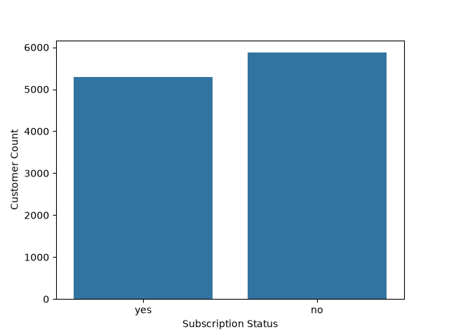
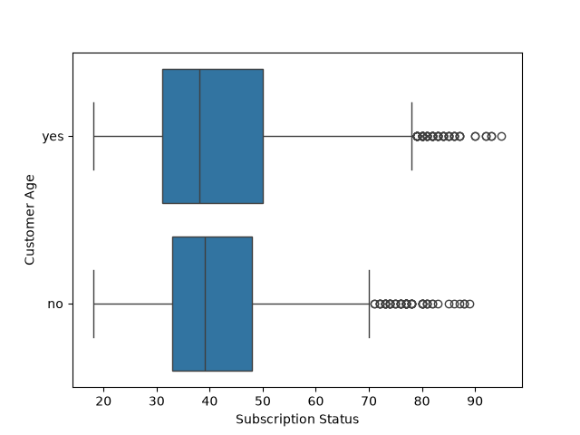
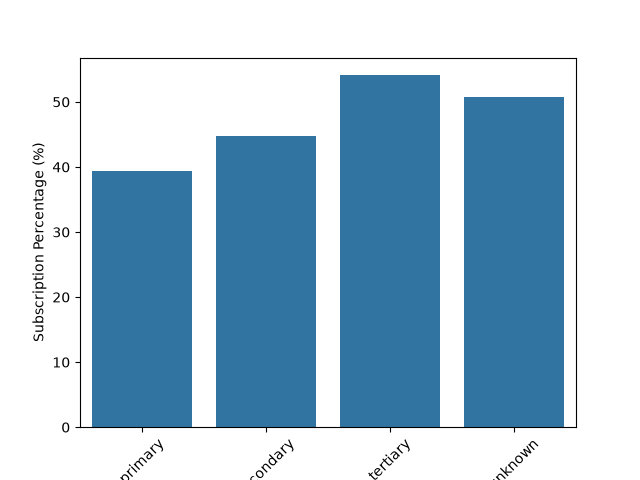
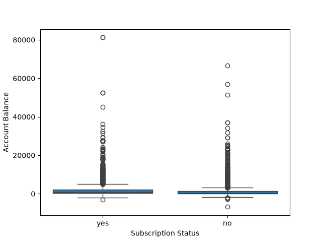
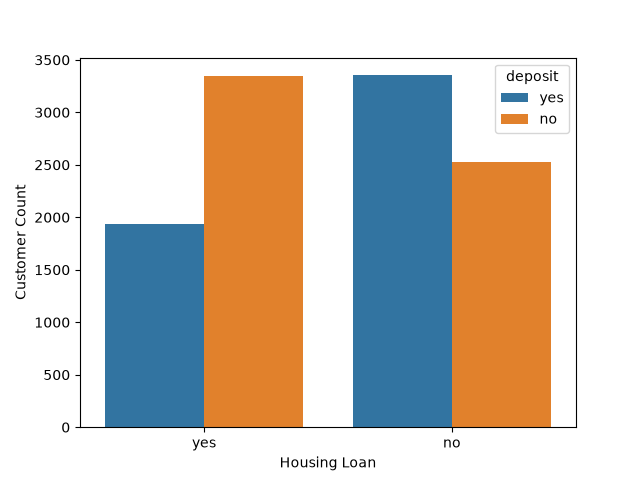

# Task 1
## Download the Kaggle Bank Marketing Dataset and use Pandas to load it into a DataFrame named bank_df, then display the first 10 rows and the DataFrame's info().
### Code
```python
import pandas as pd
bank_df=pd.read_csv('bank.csv')
print(bank_df.head(10))
print(bank_df.info())
```
### Output
```
   age         job   marital  education default  ...  campaign  pdays  previous poutcome deposit
0   59      admin.   married  secondary      no  ...         1     -1         0  unknown     yes
1   56      admin.   married  secondary      no  ...         1     -1         0  unknown     yes
2   41  technician   married  secondary      no  ...         1     -1         0  unknown     yes
3   55    services   married  secondary      no  ...         1     -1         0  unknown     yes
4   54      admin.   married   tertiary      no  ...         2     -1         0  unknown     yes
5   42  management    single   tertiary      no  ...         2     -1         0  unknown     yes
6   56  management   married   tertiary      no  ...         1     -1         0  unknown     yes
7   60     retired  divorced  secondary      no  ...         1     -1         0  unknown     yes
8   37  technician   married  secondary      no  ...         1     -1         0  unknown     yes
9   28    services    single  secondary      no  ...         3     -1         0  unknown     yes

[10 rows x 17 columns]
<class 'pandas.DataFrame'>
RangeIndex: 11162 entries, 0 to 11161
Data columns (total 17 columns):
 #   Column     Non-Null Count  Dtype
---  ------     --------------  -----
 0   age        11162 non-null  int64
 1   job        11162 non-null  str  
 2   marital    11162 non-null  str  
 3   education  11162 non-null  str  
 4   default    11162 non-null  str  
 5   balance    11162 non-null  int64
 6   housing    11162 non-null  str  
 7   loan       11162 non-null  str  
 8   contact    11162 non-null  str  
 9   day        11162 non-null  int64
 10  month      11162 non-null  str  
 11  duration   11162 non-null  int64
 12  campaign   11162 non-null  int64
 13  pdays      11162 non-null  int64
 14  previous   11162 non-null  int64
 15  poutcome   11162 non-null  str  
 16  deposit    11162 non-null  str  
dtypes: int64(7), str(10)
memory usage: 1.4 MB
None
```
<br>
<br>

# Task 2
## Use Seaborn's countplot to visualize how many customers in the dataset subscribed to a term deposit (column 'y'), and display the plot with appropriate axis labels.
### Code
```python
import pandas as pd
import seaborn as sns
import matplotlib.pyplot as plt
bank_df=pd.read_csv('bank.csv')
sns.countplot(data=bank_df,x='deposit')
plt.xlabel('Subscription Status')
plt.ylabel('Customer Count')
plt.savefig('subscription.png')
plt.show()
```
### Output

<br>

# Task 3
## Analyze the relationship between customer age and term deposit subscription by creating a Seaborn boxplot with 'y' on the x-axis and 'age' on the y-axis.<br><br><em><strong>Hint:</strong> This helps you see if certain age groups are more likely to subscribe.</em>
### Code
```python
import pandas as pd
import seaborn as sns
import matplotlib.pyplot as plt
bank_df=pd.read_csv('bank.csv')
sns.boxplot(data=bank_df,x='age',y='deposit')
plt.xlabel('Subscription Status')
plt.ylabel('Customer Age')
plt.savefig('subscription_age.png')
plt.show()
```
### Output

<br>

# Task 4
## Create a bar plot using Seaborn to show the percentage of customers who subscribed to a term deposit for each education level (column 'education').<br><br><em><strong>Hint:</strong> Calculate the percentage for each group before plotting.</em>
### Code
```python
import pandas as pd
import seaborn as sns
import matplotlib.pyplot as plt
bank_df=pd.read_csv('bank.csv')
edu_pct=bank_df.groupby('education')['deposit'].apply(lambda x:(x=='yes').mean()*100).reset_index(name='percentage')
sns.barplot(data=edu_pct,x='education',y='percentage')
plt.xlabel('Education Level')
plt.ylabel('Subscription Percentage (%)')
plt.xticks(rotation=45)
plt.savefig('term_education.png')
plt.show()
```
### Output

<br>

# Task 5
## Use ChatGPT or Copilot to suggest two additional visualizations that could help a fintech startup like Cred understand which users are most likely to buy a new savings product, then implement one of those visualizations using Seaborn.
### Code 1
Implementation 1: Account Balance vs. Term Deposit Subscription (Boxplot)
Account balance distribution grouped by term deposit subscription status to analyze the financial liquidity of potential buyers.
```python
# 
import pandas as pd
import seaborn as sns
import matplotlib.pyplot as plt
bank_df=pd.read_csv('bank.csv')
sns.boxplot(data=bank_df,x='deposit',y='balance')
plt.xlabel('Subscription Status')
plt.ylabel('Account Balance')
plt.savefig('task5_1.png')
plt.show()
```
### Output

<br>

### Code 2
Implementation 2: Housing Loan Impact on Term Deposit Subscription (Countplot)
Impact of existing housing loans on term deposit subscription rates using a count plot.
```python
import pandas as pd
import seaborn as sns
import matplotlib.pyplot as plt
bank_df=pd.read_csv('bank.csv')
sns.countplot(data=bank_df,x='housing',hue='deposit')
plt.xlabel('Housing Loan')
plt.ylabel('Customer Count')
plt.savefig('task5_2.png')
plt.show()
```
### Output

<br>

