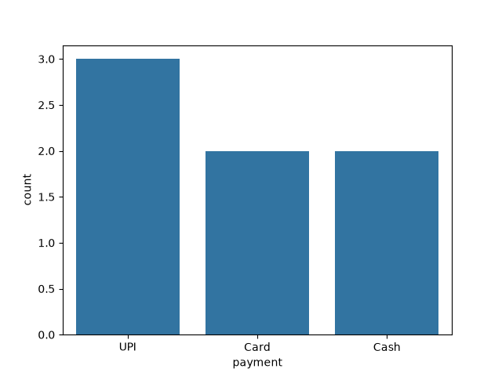
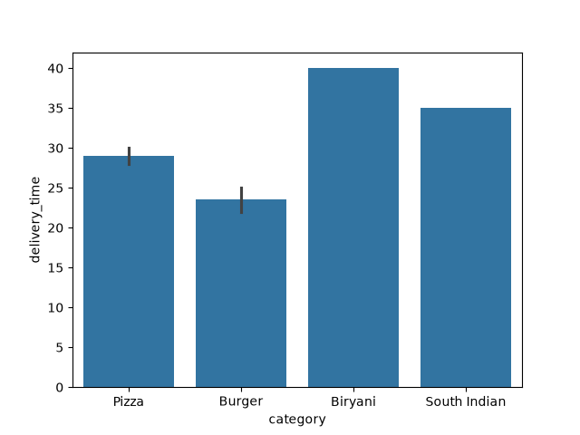
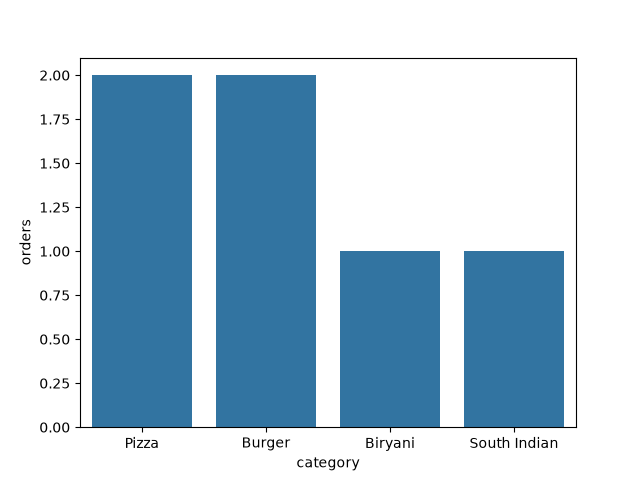
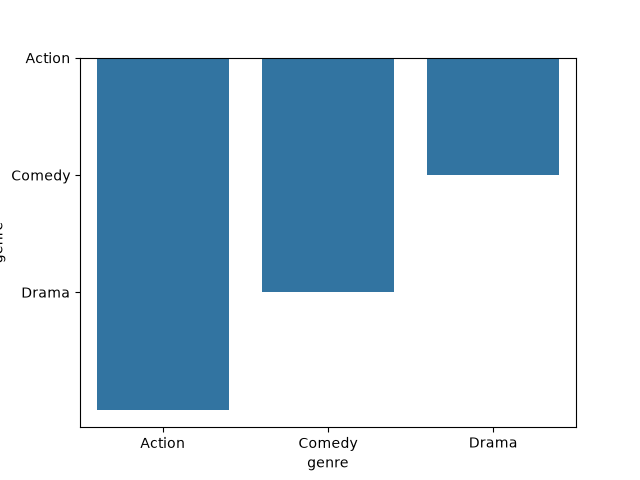

# Task 1
## Use sns.countplot() to visualize the number of orders placed by each payment method (e.g., UPI, Card, Cash) in a sample Swiggy orders DataFrame with at least 3 payment types.
### Code
```python
import pandas as pd
import seaborn as sns
import matplotlib.pyplot as plt
df=pd.DataFrame({'payment':['UPI','Card','Cash','UPI','Card','Cash','UPI']})
sns.countplot(x='payment',data=df)
plt.savefig('orders.png')
plt.show()
```
### Output

<br>

# Task 2
## Create a barplot using sns.barplot() to show the average delivery time (in minutes) for each food category (e.g., Pizza, Burger, Biryani, South Indian) from a Zomato-style dataset.<br><br><em><strong>Hint:</strong> Use the estimator parameter to show the mean delivery time for each category.</em>
### Code
```python
import pandas as pd
import seaborn as sns
import matplotlib.pyplot as plt
import numpy as np
df=pd.DataFrame({'category':['Pizza','Burger','Biryani','South Indian','Pizza','Burger'],
                 'delivery_time':[30,25,40,35,28,22],'orders':[1,1,1,1,1,1]})
sns.barplot(x='category',y='delivery_time',data=df,estimator=np.mean)
plt.savefig('delivery_time.png')
plt.show()
```
### Output

<br>

# Task 3
## Modify your barplot to display the total number of orders instead of the average by setting estimator to sum in sns.barplot().
### Code
```python
import pandas as pd
import seaborn as sns
import matplotlib.pyplot as plt
df=pd.DataFrame({'category':['Pizza','Burger','Biryani','South Indian','Pizza','Burger'],
                 'delivery_time':[30,25,40,35,28,22],'orders':[1,1,1,1,1,1]})
sns.barplot(x='category',y='orders',data=df,estimator=sum)
plt.savefig('total_orders.png')
plt.show()
```
### Output

<br>

# Task 4
## Plot a countplot of movie genres from a BookMyShow-style dataset, but remove the confidence interval from the plot.<br><br><em><strong>Hint:</strong> Use the ci=None parameter to remove confidence intervals in sns.barplot().</em>
### Code
```python
import pandas as pd
import seaborn as sns
import matplotlib.pyplot as plt
df=pd.DataFrame({'genre':['Action','Comedy','Drama','Action','Comedy','Action']})
sns.barplot(x='genre',y='genre',data=df,estimator=len,ci=None)
plt.savefig('movie_genres.png')
plt.show()
```
### Output
