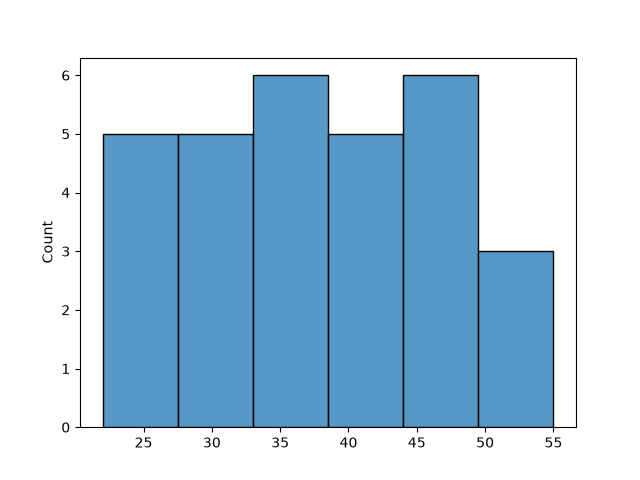
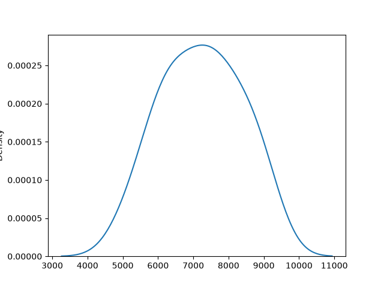
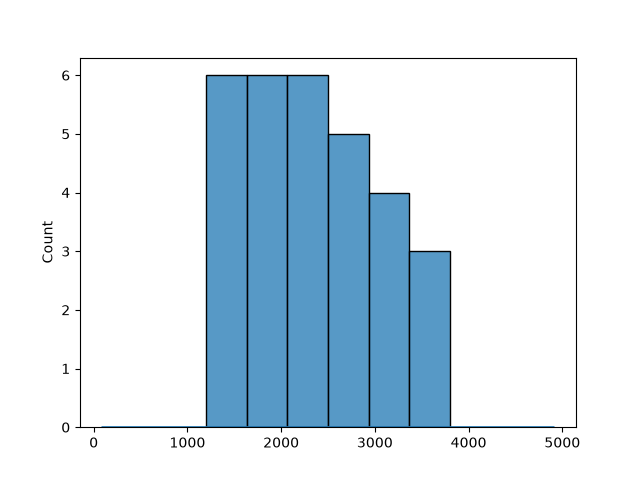
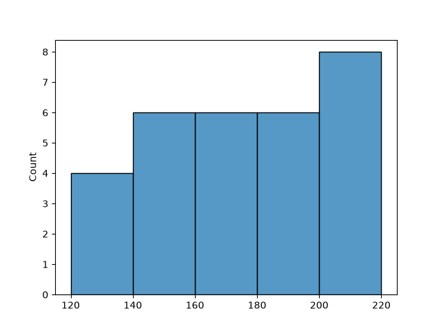
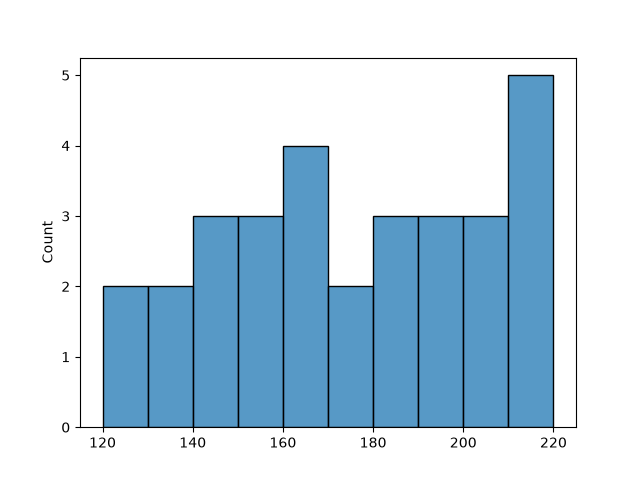
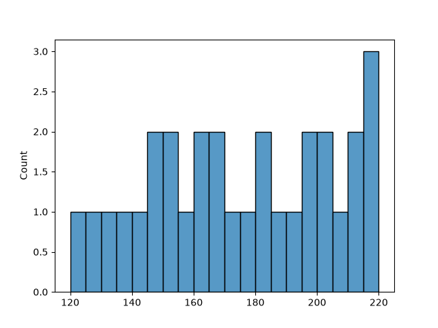

# Task 1
## Import Seaborn and use sns.histplot() to visualize the distribution of delivery times (in minutes) from a sample Swiggy order dataset with at least 30 values.
### Code
```python
import matplotlib.pyplot as plt
import seaborn as sns
data=[25,30,35,40,45,50,22,28,33,38,
      42,48,26,31,36,41,46,52,24,29,
      34,39,44,49,27,32,37,43,47,55]
sns.histplot(data)
plt.savefig('swiggy_orders.png')
plt.show()
```
### Output

<br>

# Task 2
## Download or create a list of daily step counts (e.g., from a fitness app) for one month and plot the distribution using sns.kdeplot(), showing the probability density curve.
### Code
```python
import matplotlib.pyplot as plt
import seaborn as sns
data=[5000,6000,7500,8000,6200,7100,8300,9000,
      5400,6800,7200,8100,6500,7700,8500,9200,
      5900,6300,7400,8800,6100,7000,7900,8400,
      5600,6700,7600,8900,6400,7300]
sns.kdeplot(data)
plt.savefig('steps.png')
plt.show()
```
### Output

<br>

# Task 3
## Combine sns.histplot() and sns.kdeplot() to visualize the distribution of monthly spending amounts (in rupees) on Zomato orders, using the same dataset for both plots on a single figure.<br><br><em><strong>Hint:</strong> Use the same data and overlay the KDE curve on the histogram by calling both functions on the same axes.</em>
### Code
```python
import matplotlib.pyplot as plt
import seaborn as sns
data=[1200,1500,2000,2500,1800,2200,3000,3500,1600,
      2100,2400,2800,1900,2300,3200,3800,1400,1700,
      2600,3100,1300,2200,2700,3300,1500,2000,2900,
      3600,1700,2400]
sns.histplot(data)
sns.kdeplot(data)
plt.savefig('zomato.png')
plt.show()
```
### Output

<br>

# Task 4
## Given a dataset of IPL match scores, use sns.histplot() to plot the run distribution. Change the number of bins and observe how the plot changes. Write 2-3 lines about what you notice.<br><br><em><strong>Hint:</strong> Try bins=5, bins=10, and bins=20.</em>
### Code
```python
import matplotlib.pyplot as plt
import seaborn as sns
data=[120,145,160,180,195,210,135,150,165,185,
      200,215,140,155,170,190,205,220,125,145,
      160,175,195,210,130,150,165,180,200,215]
sns.histplot(data,bins=5)
plt.savefig('ipl1.png')
plt.show()
sns.histplot(data,bins=10)
plt.savefig('ipl2.png')
plt.show()
sns.histplot(data,bins=20)
plt.savefig('ipl3.png')
plt.show()
```
### Output



With fewer bins the distribution appears overly aggregated, masking fine-grained frequency variations. Increasing the bins to 10 and 20 reveals greater structural detail and distribution shape, though too many bins can make the plot fragmented and noisy.