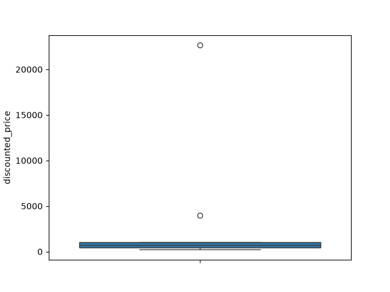
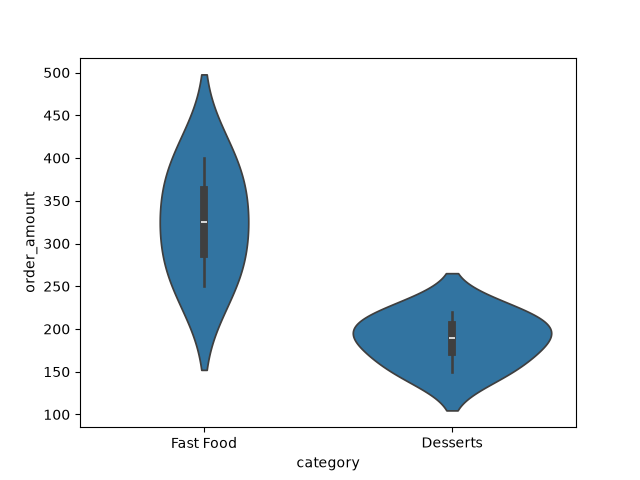
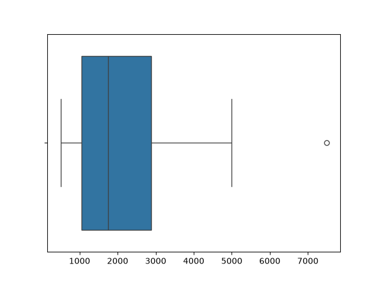
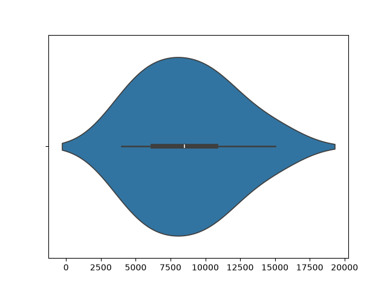

# Task 1
## Load a CSV file containing Flipkart product prices and use sns.boxplot() to visualize the price distribution.
### Code
```python
import pandas as pd
import seaborn as sns
import matplotlib.pyplot as plt
df=pd.read_csv('flipkart_prices.csv')
sns.boxplot(y=df['discounted_price'])
plt.savefig('flipkart_prices.png')
plt.show()
```
### Output

<br>

# Task 2
## Use sns.violinplot() to compare the order amounts for two different Zomato restaurant categories (e.g., 'Fast Food' vs 'Desserts') from a sample dataset.
### Code
```python
import pandas as pd
import seaborn as sns
import matplotlib.pyplot as plt
data={'category':['Fast Food','Fast Food','Fast Food','Desserts','Desserts',
                  'Desserts','Fast Food','Desserts'], 
                  'order_amount':[250,300,350,150,200,180,400,220]}
df=pd.DataFrame(data)
sns.violinplot(x='category',y='order_amount',data=df)
plt.savefig('zomato_orders.png')
plt.show()
```
### Output

<br>

# Task 3
## Given an array of IPL match ticket prices, plot a boxplot using sns.boxplot() and identify any outliers in the data.<br><br><em><strong>Hint:</strong> Outliers are points that appear outside the whiskers of the boxplot.</em>
### Code
```python
import seaborn as sns
import matplotlib.pyplot as plt
prices=[500,750,1000,1200,1500,2000,2500,3000,5000,7500]
sns.boxplot(x=prices)
plt.savefig('ipl_prices.png')
plt.show()
```
### Output

<br>

# Task 4
## Create a violin plot using sns.violinplot() to show the distribution of daily step counts collected from a fitness app like Google Fit, and explain what the shape of the plot tells you about user activity.
### Code
```python
import seaborn as sns
import matplotlib.pyplot as plt
steps=[4000,5000,6000,7000,8000,9000,10000,11000,12000,15000]
sns.violinplot(x=steps)
plt.savefig('step_counts.png')
plt.show()
```
### Output
