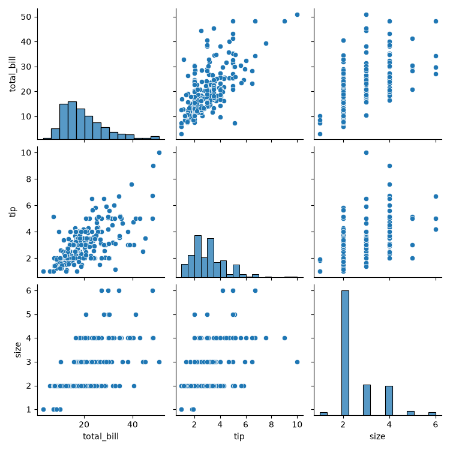
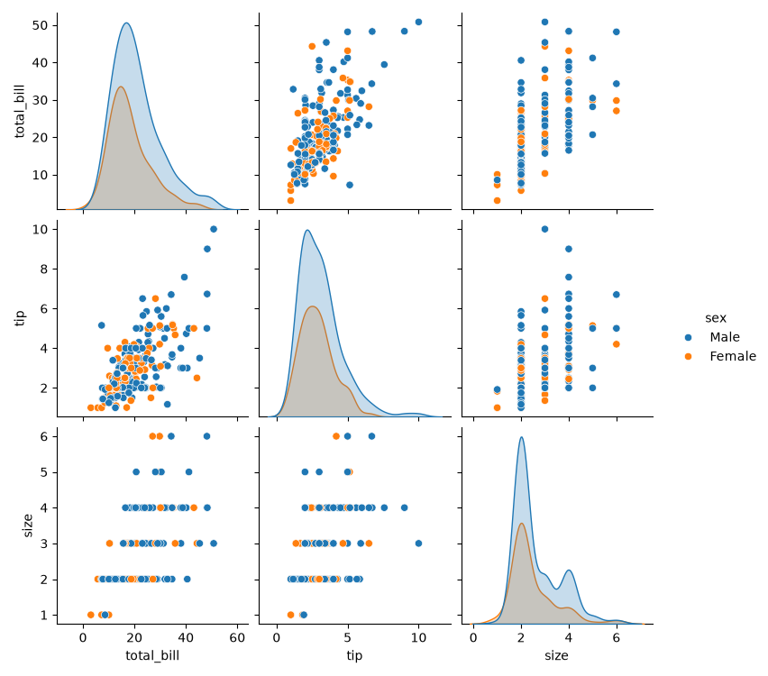
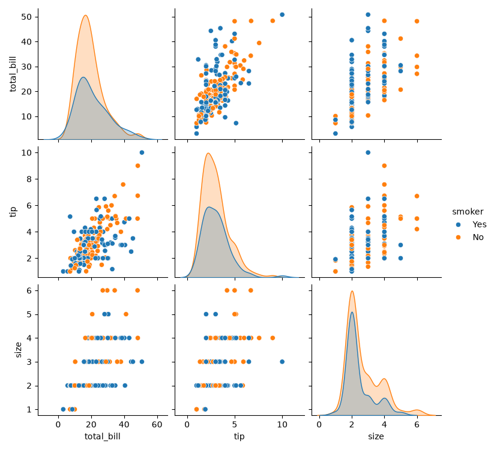
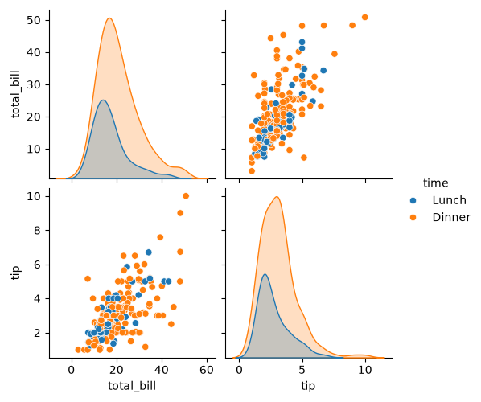

# Task 1
## Load the 'tips' dataset from seaborn and create a basic pairplot for all numerical columns.
### Code
```python
import seaborn as sns
import matplotlib.pyplot as plt
df=sns.load_dataset('tips')
sns.pairplot(df)
plt.savefig('tips.png')
plt.show()
```
### Output

<br>

# Task 2
## Use the pairplot function to visualize the 'tips' dataset, but this time set the hue parameter to 'sex' and observe how the data points are colored based on gender.
### Code
```python
import seaborn as sns
import matplotlib.pyplot as plt
df=sns.load_dataset('tips')
sns.pairplot(df,hue='sex')
plt.savefig('hue.png')
plt.show()
```
### Output

<br>

# Task 3
## Create a pairplot for the 'tips' dataset with the hue set to 'smoker', and set the diag_kind parameter to 'kde' to show kernel density estimates on the diagonal plots.<br><br><em><strong>Hint:</strong> Use diag_kind='kde' in the pairplot function.</em>
### Code
```python
import seaborn as sns
import matplotlib.pyplot as plt
df=sns.load_dataset('tips')
sns.pairplot(df,hue='smoker',diag_kind='kde')
plt.savefig('hue_kde.png')
plt.show()
```
### Output

<br>

# Task 4
## Pick any two numerical columns from the 'tips' dataset and use pairplot to visualize only those columns, setting hue to 'time' (Lunch/Dinner).<br><br><em><strong>Constraint:</strong> Use the vars parameter to select the columns.</em>
### Code
```python
import seaborn as sns
import matplotlib.pyplot as plt
df=sns.load_dataset('tips')
sns.pairplot(df,vars=['total_bill','tip'],hue='time')
plt.savefig('hue_time.png')
plt.show()
```
### Output
