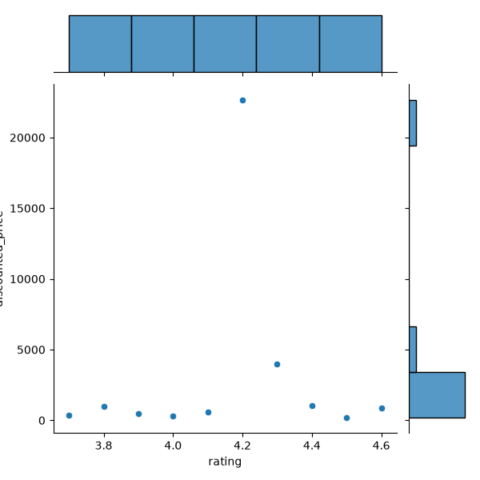
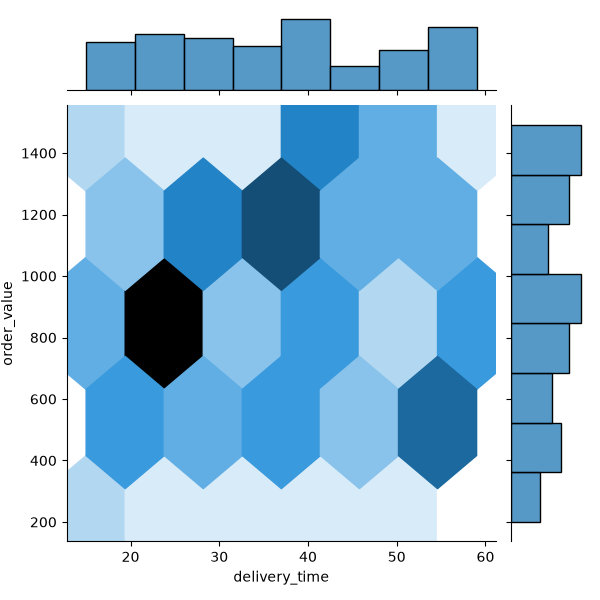
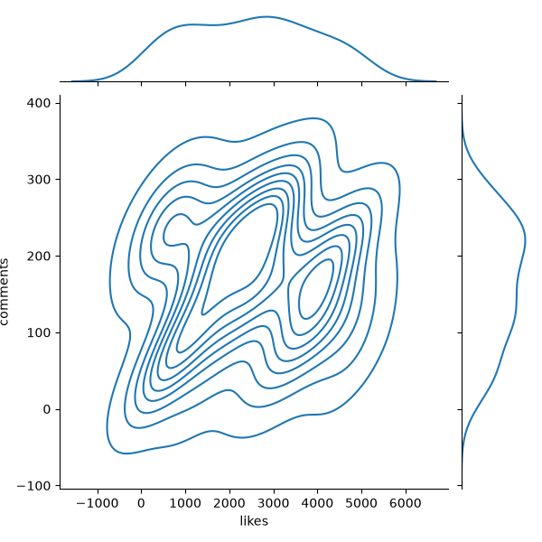
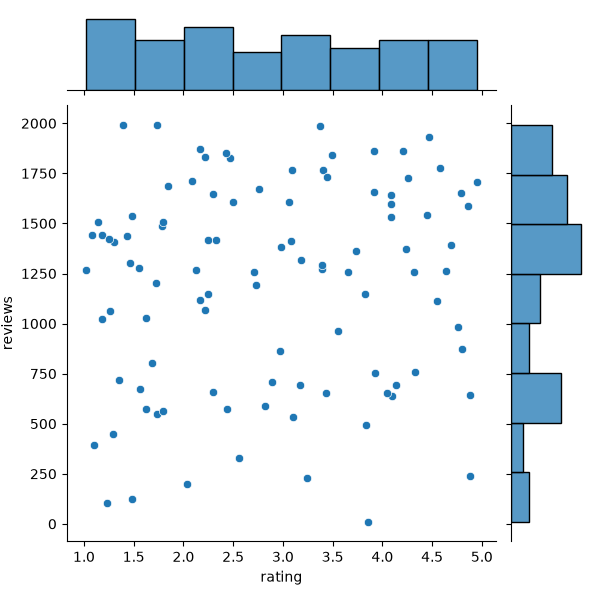
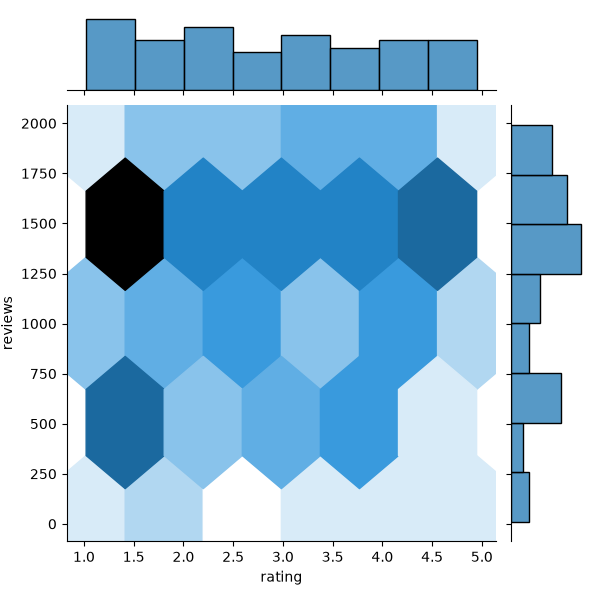
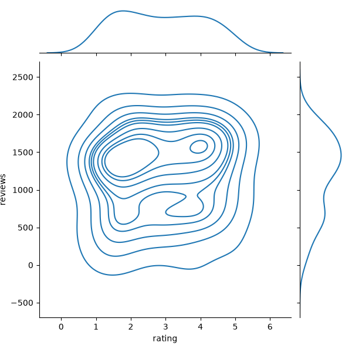

# Task 1
## Load a CSV file containing Flipkart product ratings and prices, then use Seaborn's jointplot with kind='scatter' to visualize the relationship between rating and price.
### Code
```python
import pandas as pd
import seaborn as sns
import matplotlib.pyplot as plt
df=pd.read_csv('flipkart_prices.csv')
sns.jointplot(x='rating',y='discounted_price',data=df,kind='scatter')
plt.savefig('flipkart_rating.png')
plt.show()
```
### Output

<br>

# Task 2
## Create a jointplot with kind='hex' to analyze the relationship between delivery time and order value using a dataset of Swiggy food orders.<br><br><em><strong>Hint:</strong> Use sns.jointplot(x='delivery_time', y='order_value', data=your_dataframe, kind='hex').</em>
### Code
```python
import pandas as pd
import numpy as np
import seaborn as sns
import matplotlib.pyplot as plt
np.random.seed(42)
df=pd.DataFrame({'delivery_time':np.random.randint(15,60,100),
                 'order_value':np.random.randint(200,1500,100)})
sns.jointplot(x='delivery_time',y='order_value',data=df,kind='hex')
plt.savefig('swiggy_plot.png')
plt.show()
```
### Output

<br>

# Task 3
## Use Seaborn's jointplot with kind='kde' to visualize how the number of likes and comments are related in a dataset of Instagram posts.
### Code
```python
import pandas as pd
import numpy as np
import seaborn as sns
import matplotlib.pyplot as plt
np.random.seed(42)
df=pd.DataFrame({'likes':np.random.randint(100,5000,100),
                 'comments':np.random.randint(5,300,100)})
sns.jointplot(x='likes',y='comments',data=df,kind='kde')
plt.savefig('instagram.png')
plt.show()
```
### Output

<br>

# Task 4
## Compare the visual insights you get from scatter, hexbin, and KDE jointplots using the same dataset of Zomato restaurant reviews (rating vs number of reviews). Briefly describe which plot type helps you understand the data best and why.
### Code
```python
import pandas as pd
import numpy as np
import seaborn as sns
import matplotlib.pyplot as plt
np.random.seed(42)
df=pd.DataFrame({'rating':np.random.uniform(1.0,5.0,100),
                 'reviews':np.random.randint(10,2000,100)})
sns.jointplot(x='rating',y='reviews',data=df,kind='scatter')
plt.savefig('zomato_scatter.png')
plt.show()
sns.jointplot(x='rating',y='reviews',data=df,kind='hex')
plt.savefig('zomato_hex.png')
plt.show()
sns.jointplot(x='rating',y='reviews',data=df,kind='kde')
plt.savefig('zomato_kde.png')
plt.show()
```
### Output



<br>
Scatter Plot: Best for identifying individual outliers, but causes severe overplotting when datasets are large.

Hexbin Plot: Best for large datasets with high density concentrations, neatly binning points into hexagonal cells to reveal clusters.

KDE Plot: Best for viewing smooth distribution contours and density estimates, though it can obscure exact data point boundaries.