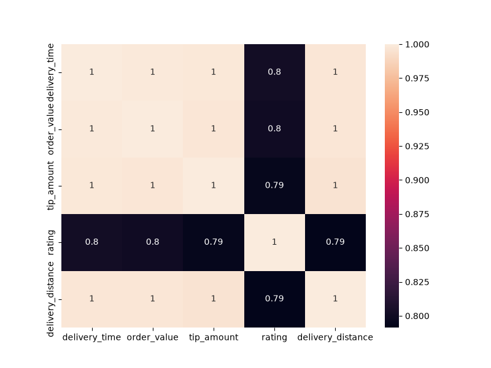
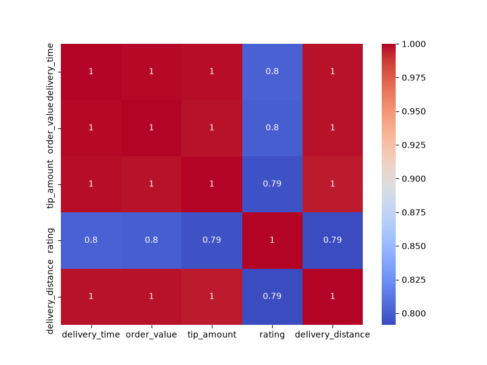
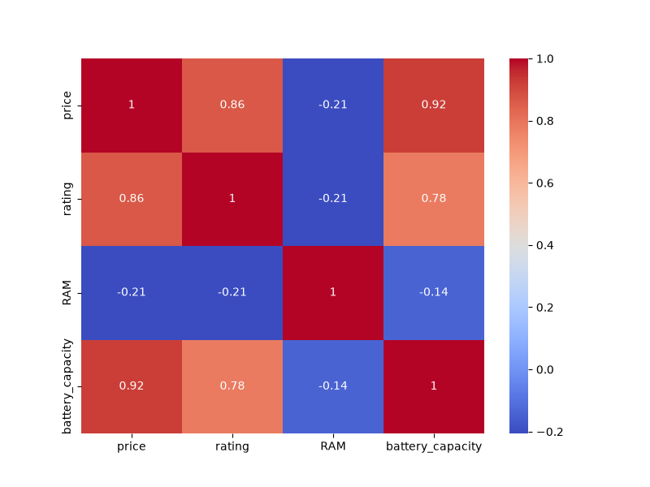

# Task 1
## Create a Pandas DataFrame with at least 5 columns representing different features of food delivery orders (e.g., delivery_time, order_value, tip_amount, rating, delivery_distance) and 20 rows of random data, then calculate and display the correlation matrix using the .corr() function.
### Code
```python
import pandas as pd
import numpy as np
np.random.seed(42)
base=np.random.uniform(1,10,20)
df=pd.DataFrame({
    'delivery_time':base*2+np.random.uniform(0,1,20),
    'order_value':base*5+np.random.uniform(0,2,20),
    'tip_amount':base*1+np.random.uniform(0,0.5,20),
    'rating':base*0.1+np.random.uniform(1,2,20),
    'delivery_distance':base*1.5+np.random.uniform(0,1,20)
})
corr=df.corr()
print(corr)
```
### Output
```
                  delivery_time  order_value  tip_amount    rating  delivery_distance
delivery_time           1.000000     0.998566    0.998260  0.801194           0.997039
order_value             0.998566     1.000000    0.997257  0.800176           0.996794
tip_amount              0.998260     0.997257    1.000000  0.794312           0.995809
rating                  0.801194     0.800176    0.794312  1.000000           0.791383
delivery_distance       0.997039     0.996794    0.995809  0.791383           1.000000
```
<br>
<br>

# Task 2
## Using Seaborn, plot a heatmap of the correlation matrix you generated for the food delivery data, and add annotations to show the correlation values inside each cell.
### Code
```python
import pandas as pd
import numpy as np
import seaborn as sns
import matplotlib.pyplot as plt
np.random.seed(42)
base=np.random.uniform(1,10,20)
df=pd.DataFrame({
    'delivery_time':base*2+np.random.uniform(0,1,20),
    'order_value':base*5+np.random.uniform(0,2,20),
    'tip_amount':base*1+np.random.uniform(0,0.5,20),
    'rating':base*0.1+np.random.uniform(1,2,20),
    'delivery_distance':base*1.5+np.random.uniform(0,1,20)
})
corr=df.corr()
plt.figure(figsize=(8,6))
sns.heatmap(corr,annot=True)
plt.savefig('food_orders.png')
plt.show()
```
### Output

<br>

# Task 3
## Change the color palette of your Seaborn heatmap to a diverging palette (such as 'coolwarm' or 'RdYlGn') to better visualize positive and negative correlations, and explain which two features in your data have the strongest negative correlation.<br><br><em><strong>Hint:</strong> Use the cmap parameter in sns.heatmap().</em>
### Code
```python
import pandas as pd
import numpy as np
import seaborn as sns
import matplotlib.pyplot as plt
np.random.seed(42)
base=np.random.uniform(1,10,20)
df=pd.DataFrame({
    'delivery_time':base*2+np.random.uniform(0,1,20),
    'order_value':base*5+np.random.uniform(0,2,20),
    'tip_amount':base*1+np.random.uniform(0,0.5,20),
    'rating':base*0.1+np.random.uniform(1,2,20),
    'delivery_distance':base*1.5+np.random.uniform(0,1,20)
})
corr=df.corr()
plt.figure(figsize=(8,6))
sns.heatmap(corr,annot=True,cmap='coolwarm')
plt.savefig('orders_diverging.png')
plt.show()
```
### Output

<br>

# Task 4
## Take the Flipkart mobile phones dataset (or any small CSV with product features you can find online), compute the correlation matrix for at least 4 numeric columns (e.g., price, rating, RAM, battery_capacity), and generate a Seaborn heatmap with annotations and a diverging color palette.
### Code
```python
import pandas as pd
import numpy as np
import seaborn as sns
import matplotlib.pyplot as plt
np.random.seed(42)
base=np.random.uniform(1,10,20)
df_flipkart=pd.DataFrame({
    'price':base*5000+np.random.uniform(1000,5000,20),
    'rating':base*0.2+np.random.uniform(2,3,20),
    'RAM':np.random.choice([4,6,8,12],20),
    'battery_capacity':base*300+np.random.uniform(2000,3000,20)
})
corr_flipkart=df_flipkart.corr()
plt.figure(figsize=(8,6))
sns.heatmap(corr_flipkart,annot=True,cmap='coolwarm')
plt.savefig('flipkart.png')
plt.show()
```
### Output
