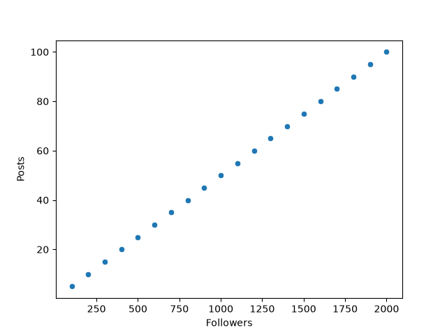
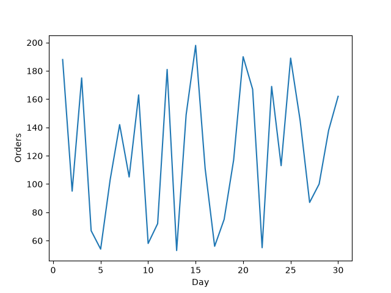
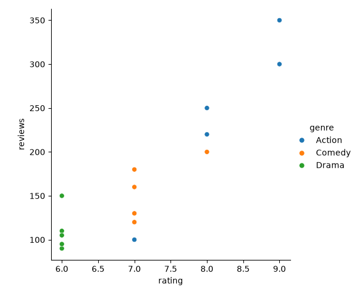
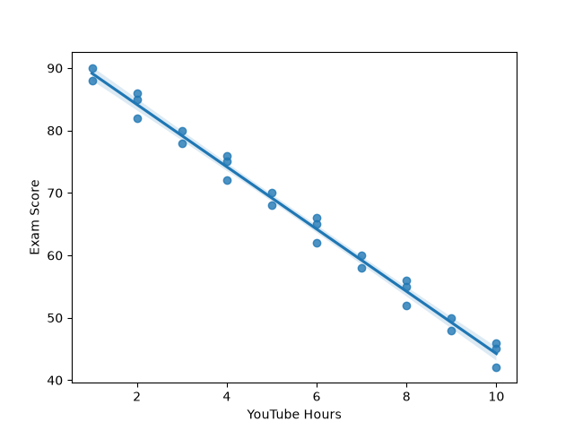

# Task 1
## Use sns.scatterplot() to visualize the relationship between the number of followers and the number of posts for 20 fictional Instagram users. Label the axes appropriately.
### Code
```python
import pandas as pd
import seaborn as sns
import matplotlib.pyplot as plt
df=pd.DataFrame({'followers':[100,200,300,400,500,600,700,800,900,
                              1000,1100,1200,1300,1400,1500,1600,
                              1700,1800,1900,2000],
                'posts':[5,10,15,20,25,30,35,40,45,
                         50,55,60,65,70,75,80,85,90,
                         95,100]})
sns.scatterplot(data=df,x='followers',y='posts')
plt.xlabel('Followers')
plt.ylabel('Posts')
plt.savefig('followers.png')
plt.show()
```
### Output

<br>

# Task 2
## Create a line plot using sns.lineplot() to show the daily number of food orders on Zomato for each day over a month. Use a list of 30 random order counts to simulate the data.
### Code
```python
import pandas as pd
import seaborn as sns
import matplotlib.pyplot as plt
import random
df=pd.DataFrame({'day':range(1,31),
                 'orders':[random.randint(50,200) for _ in range(30)]})
sns.lineplot(data=df,x='day',y='orders')
plt.xlabel('Day')
plt.ylabel('Orders')
plt.savefig('zom_orders.png')
plt.show()
```
### Output

<br>

# Task 3
## Using sns.relplot(), plot the relationship between movie ratings and the number of reviews for different genres (Action, Comedy, Drama) based on a sample dataset of 15 movies. Use the 'hue' parameter to differentiate genres.<br><br><em><strong>Hint:</strong> Create a DataFrame with columns: 'movie', 'rating', 'reviews', and 'genre'.</em>
### Code
```python
import pandas as pd
import seaborn as sns
import matplotlib.pyplot as plt
df=pd.DataFrame({'movie':[f'M{i}' for i in range(1,16)],
                 'rating':[7,8,6,9,7,6,8,7,6,8,7,6,9,7,6],
                 'reviews':[100,200,150,300,120,90,250,180,110,220,130,95,350,160,105],
                 'genre':['Action','Comedy','Drama']*5})
sns.relplot(data=df,x='rating',y='reviews',hue='genre')
plt.savefig('movies.png')
plt.show()
```
### Output

<br>

# Task 4
## Generate a regression plot using sns.regplot() to analyze the correlation between the number of hours spent on YouTube and exam scores for a group of 25 students. Interpret whether the trend is positive or negative.
### Code
```python
import pandas as pd
import seaborn as sns
import matplotlib.pyplot as plt
df=pd.DataFrame({'youtube_hours':[1,2,3,4,5,6,7,8,9,10,
                                  1,2,3,4,5,6,7,8,9,10,
                                  2,4,6,8,10],
                'exam_score':[90,85,80,75,70,65,60,55,50,
                              45,88,82,78,72,68,62,58,52,
                              48,42,86,76,66,56,46]})
sns.regplot(data=df,x='youtube_hours',y='exam_score')
plt.xlabel('YouTube Hours')
plt.ylabel('Exam Score')
plt.savefig('youtube.png')
print('The trend is negative')
plt.show()
```
### Output

```
The trend is negative
```ss