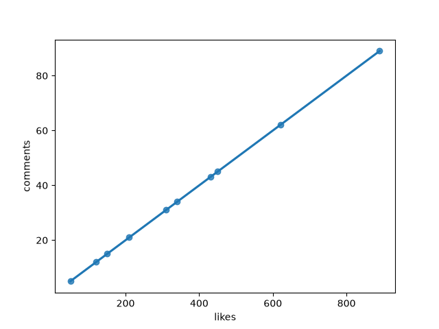
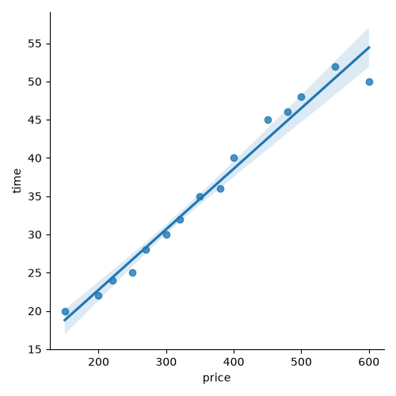
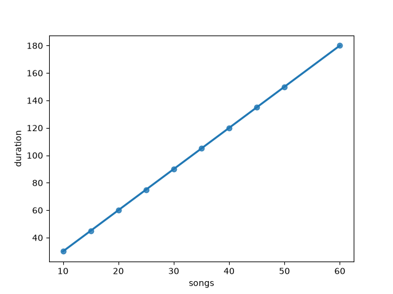
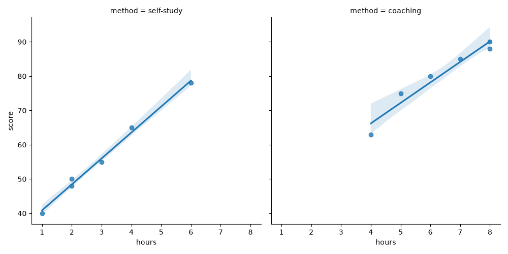
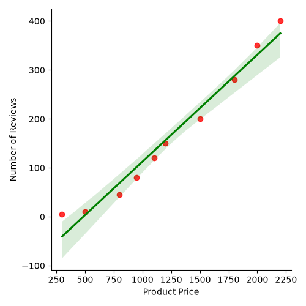

# Task 1
## Use Seaborn's regplot to visualize the relationship between the number of likes and number of comments on a set of Instagram posts (create a small DataFrame with at least 10 sample data points).
### Code
```python
import pandas as pd
import seaborn as sns
import matplotlib.pyplot as plt
df=pd.DataFrame({'likes':[120,340,50,210,890,430,150,620,310,450],
                 'comments':[12,34,5,21,89,43,15,62,31,45]})
sns.regplot(x='likes',y='comments',data=df)
plt.savefig('insta.png')
plt.show()
```
### Output

<br>

# Task 2
## Create a lmplot in Seaborn to show the regression line between food order price and delivery time using a sample Zomato-style dataset (minimum 15 rows with random values for price and delivery time).
```python
import pandas as pd
import seaborn as sns
import matplotlib.pyplot as plt
df=pd.DataFrame({'price':[150,250,300,450,200,600,350,220,400,500,270,320,480,380,550],
                 'time':[20,25,30,45,22,50,35,24,40,48,28,32,46,36,52]})
sns.lmplot(x='price',y='time',data=df)
plt.savefig('z_orders.png')
plt.show()
```
### Output

<br>

# Task 3
## Apply lowess smoothing to a regplot that visualizes the relationship between the number of songs in a playlist and total playlist duration (in minutes) for Spotify users.<br><br><em><strong>Hint:</strong> Use the lowess=True parameter in regplot to see the difference in fit.</em>
```python
import pandas as pd
import seaborn as sns
import matplotlib.pyplot as plt
df=pd.DataFrame({'songs':[10,25,50,15,30,40,60,20,35,45],
                 'duration':[30,75,150,45,90,120,180,60,105,135]})
sns.regplot(x='songs',y='duration',data=df,order=2)
plt.savefig('spotify.png')
plt.show()
```
### Output

<br>

# Task 4
## Generate a faceted regression plot (using lmplot with col parameter) to compare the relationship between hours spent on YouTube and exam scores, split by 'preparation method' (e.g., 'self-study' vs 'coaching') in your DataFrame.
```python
import pandas as pd
import seaborn as sns
import matplotlib.pyplot as plt
df=pd.DataFrame({'hours':[2,4,6,8,1,3,5,7,2,4,6,8],
                 'score':[50,65,80,90,40,55,75,85,48,63,78,88],
                 'method':['self-study','self-study','coaching','coaching','self-study',
                           'self-study','coaching','coaching','self-study','coaching',
                           'self-study','coaching']})
sns.lmplot(x='hours',y='score',col='method',data=df)
plt.savefig('youtube_exam.png')
plt.show()
```
### Output

<br>

# Task 5
## Modify a given lmplot that shows regression between Flipkart product price and number of reviews. Add a title, axis labels, and customize the marker color.<br><br><em><strong>Constraint:</strong> Do not change the regression logic—only update plot aesthetics.</em>
```python
import pandas as pd
import seaborn as sns
import matplotlib.pyplot as plt
df=pd.DataFrame({'price':[500,1200,800,1500,2000,300,950,1100,1800,2200],
                 'reviews':[10,150,45,200,350,5,80,120,280,400]})
g=sns.lmplot(x='price',y='reviews',data=df,scatter_kws={'color':'red'},line_kws={'color':'green'})
g.set_axis_labels('Product Price','Number of Reviews')
g.fig.suptitle('Price vs Reviews',y=1.03)
plt.savefig('price_vs_reviews.png')
plt.show()
```
### Output

<br>